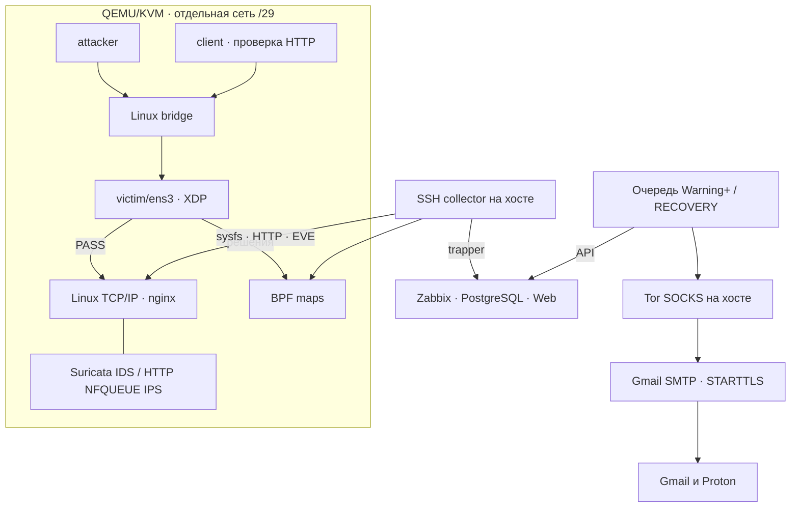

# OPLA Security Lab

**Воспроизводимые эксперименты с сетевой защитой Linux: eBPF/XDP, Suricata IDS/IPS, Zabbix и проверяемое восстановление стенда.**

C / eBPF · Python · Bash · QEMU/KVM · nftables · nginx · PostgreSQL · Ansible

[Быстрый старт](#быстрый-старт) · [XDP](#защита-ebpfxdp) · [Zabbix](#метрики-и-панели-zabbix) · [Испытания](#проверки-и-эксперименты) · [CI/CD](#cicd) · [Ограничения](#ограничения-и-модель-доверия)

> **Статус: лабораторный release candidate.** Native XDP и отдельные защитные сценарии проверены на живом стенде. GitLab pipeline [#2985024140](https://gitlab.com/k3rnel_co0n/opla-security-lab/-/pipelines/2985024140) прошёл для `96ef03bb`: тесты, проверка конфигураций, компиляция BPF и упаковка. Полная установка с нуля, восстановление после перезагрузки хоста и развёртывание Ansible на отдельном сервере остаются отдельными критериями приёмки. Проект не заявляет универсальную защиту L2–L7 или промышленную готовность.

## Что делает проект

OPLA связывает защитное решение с наблюдаемыми данными: пакетом, BPF-счётчиком, событием Suricata, HTTP-ответом, проблемой Zabbix и уведомлением. Три ВМ разделяют роли источника тестового трафика, защищаемого сервиса и независимого клиента.

- XDP разбирает заголовки, ограничивает начальные TCP SYN и обнаруживает сканирование по различным портам источника.
- Suricata обнаруживает события в режиме IDS или блокирует выбранный HTTP-трафик через NFQUEUE.
- nginx ограничивает HTTP-запросы и пишет структурированный журнал.
- Zabbix автоматически получает host, items, preprocessing, triggers, graphs и dashboard.
- Очередь уведомлений отправляет Warning+ и восстановления на Gmail и Proton через Gmail SMTP/TLS и Tor.
- QMP позволяет сохранить и откатить состояние отдельной ВМ; отдельные команды создают проверяемые дисковые копии и дамп БД.
- CI проверяет переносимую логику, конфигурации и собирает BPF object с контрольными суммами.

## Демонстрация


[Видео MP4](assets/demo/terminal-replay.mp4) · [Исходные числовые результаты](assets/demo/observed-results.json)

Ролик — воспроизведение ранее сохранённого терминального вывода, **не запись нового запуска**. Он показывает ранние SYN/HTTP-опыты; число метрик в его данных относится к той версии. Скорость кадров не является измерением производительности. Текущие XDP scan policy и CI описаны ниже. Реальные скриншоты новых панелей в этот релиз не добавлены.

## Архитектура



Сеть ВМ создаётся динамически; текущие адреса читаются из `LAB_DIR/state.env`. Для примеров ниже использован наблюдавшийся стенд `100.64.0.0/29`: host `.1`, attacker `.2`, victim `.3`, client `.4`. Эти адреса нельзя переносить на другой экземпляр без проверки.

В IDS используется AF_PACKET. В IPS выбранный входящий HTTP/80 и соответствующие ответы направляются в NFQUEUE 42. Это отдельный профиль, а не inline-фильтрация всех протоколов. Native XDP DROP происходит раньше обычного захвата пакетов; пассивный сенсор может его не увидеть.

## Требования

| Компонент | Требование / проверенная среда |
|---|---|
| Хост | Linux amd64, systemd, доступный `/dev/kvm`, sudo и отдельная лабораторная машина |
| Виртуализация | QEMU, qemu-img, cloud-image-utils, dnsmasq, libguestfs, socat |
| Управление | Python 3, PyYAML, Bash, OpenSSH client, iproute2, nftables, curl, make, C compiler |
| Мониторинг | Docker Engine и Docker Compose plugin |
| Ресурсы | Практический минимум 8 GiB RAM и 20 GiB диска; копии и snapshots требуют дополнительного места |
| Проверенный запуск | Host Debian 13/QEMU 10; guests Debian 12/kernel 6.1; clang 14, bpftool 7.1; Suricata 7.0.10 |
| Переносимые тесты | Debian-пакеты `gcc libc6-dev linux-libc-dev make python3 python3-yaml qemu-utils` |

`bin/install-host.sh` рассчитан на **чистый Debian 12**. Это не универсальный установщик Debian 13, Ubuntu или Astra Linux. Не запускайте его на существующем рабочем хосте ради проверки зависимостей. Для ключа управления ожидается `~/.ssh/id_ed25519`; приватный ключ не копируется в репозиторий.

Образы QEMU и контейнеров скачиваются отдельно. ВМ лабораторного профиля не получают default gateway и DNS для внешнего доступа; изоляцию дополнительно обеспечивают отдельные nftables-правила. Подготовка образов выполняется через libguestfs, не через открытие Интернета гостевым ВМ.

## Быстрый старт

Скачайте исходники через **Code → Download ZIP** или клонируйте URL выбранного репозитория. Все команды хоста ниже выполняются из корня исходников. Сначала проверьте код:

```bash
make check
```

### Образы и ВМ

На подготовленном хосте:

```bash
make bootstrap
make image ROLE=attacker
make image ROLE=client
make image ROLE=victim
make up
make ready
export LAB_DIR="$(python3 bin/state.py --latest)"
```

**Известная граница чистой установки:** `prepare-image.sh` использует обычный `--install`. В наблюдавшейся Debian 12 конфигурации Suricata требовала согласованной установки с `libhtp2` из bookworm-backports. Эта операция была выполнена вручную на остановленной victim; автоматическая чистая сборка victim с тем же набором ещё не подтверждена. При ошибке образа остановитесь на ней; последующие команды не исправляют APT-зависимости.

Отдельные role images уменьшают состав пакетов attacker/client. При отсутствии role image create-lab может использовать victim image как fallback. Поэтому роль ВМ сама по себе не гарантирует минимальный состав пакетов. Nmap/arp-scan/Yersinia, использованные в опытах, были добавлены в конкретную attacker отдельно; текущий image script их не устанавливает.

### Подключение XDP

```bash
make xdp-all THRESHOLD=100 MAX_SOURCES=4096
make xdp-stats
```

Ожидайте `loaded: 1` и проверьте `mode`. Загрузчик пробует native; generic fallback не означает native-производительность. Он не заменяет уже присоединённую программу автоматически. Для намеренного обновления своей программы используйте `make xdp-unload`, затем сборку/загрузку; это прерывает защиту и пересоздаёт счётчики.

### Мониторинг и HTTP

```bash
make monitoring-up
```

Откройте `http://127.0.0.1:8080`, смените начальный пароль `Admin/zabbix`, затем:

```bash
bash bin/observability-up.sh
```

Скрипт устанавливает HTTP-политику, развёртывает collector, выполняет provisioning через API и запускает сбор. Он не загружает XDP и не включает Suricata/scan detector автоматически.

```bash
make ids
make ids-status
bash bin/scan-detector.sh start
```

Для HTTP IPS вместо IDS:

```bash
make ips
make ids-status
```

В этом профиле остановка IPS engine может сделать выбранный HTTP-путь недоступным. Управление должно оставаться на отдельном доступном пути.

## Защита eBPF/XDP

Обработчик: [xdp/xdp_ddos_protect.c](xdp/xdp_ddos_protect.c).

| Механизм | Область действия |
|---|---|
| Разбор Ethernet/VLAN/IPv4/TCP | Проверки границ, IPv4 IHL и длин TCP; поддержка до двух VLAN-тегов |
| SYN rate limit | Начальные IPv4 TCP SYN, по источнику, фиксированное окно; default 100 за 1 секунду |
| Fragment policy | Фрагментированный IPv4 TCP отбрасывается в данном лабораторном профиле |
| Distinct-port scan | 8 различных destination ports за фиксированное окно 60 секунд на IPv4 source |
| Временный запрет | В режиме block новые SYN источника отбрасываются 30 секунд |
| Ограниченная карта | Default 4096 источников; при невозможности добавить источник SYN отбрасывается, растёт map_full |

```bash
bash bin/xdp-scan-policy.sh observe
bash bin/xdp-scan-policy.sh block
bash bin/xdp-scan-policy.sh off
bash bin/source-map.sh
```

Режимы выполняйте по одному для выбранного опыта. `observe` регистрирует событие, `block` добавляет временное отбрасывание, `off` отключает только scan policy. После загрузки новой карты scan policy по умолчанию off; её нужно применить снова.

Два trusted IPv4 source — управление и независимый client — обходят **только scan policy**, а не SYN rate limit. Wrapper читает их из состояния стенда. После включения block первые пробы до порога могут пройти; уже установленные соединения и ACK этим механизмом не запрещаются. ARP discovery также не блокируется.

### Карты и счётчики

| Карта | Содержимое |
|---|---|
| `syn_windows` | Spin lock, SYN-window, различные порты и срок временного запрета по source IP |
| `xdp_policy` | Текущий режим и два trusted source |
| `xdp_stats` | Per-CPU array из 7 счётчиков |

Программа закрепляется в `/sys/fs/bpf/opla/program`, карты — в `/sys/fs/bpf/opla/maps`.

`xdp_stats`: `syn`, `pass`, `drop`, `map_full`, `fragment_drop`, `xdp_scan_events`, `xdp_scan_drop`.
`pass/drop` относятся к учтённым начальным SYN; `xdp_scan_drop` — подмножество общего `drop`. Повреждённые пакеты могут отбрасываться без увеличения SYN-счётчиков. Collector суммирует значения всех CPU.

`loaded=1` — булев признак присоединённой программы, а не число правил, карт или датчиков. `rx_packets/rx_bytes` берутся из sysfs, HTTP — из nginx и локального probe, IDS — из EVE. Эти значения не являются дополнительными XDP-картами.

## Метрики и панели Zabbix

Текущий provisioning создаёт **49 items: 34 исходных значения и 15 скоростей, 23 triggers, 5 graphs и dashboard из 5 страниц**:

| Страница | Данные |
|---|---|
| XDP and events | Присоединение, режим, SYN, drop, давление на карту и XDP scan policy |
| HTTP protection | Запросы, rate limiting, ошибки и локальная HTTP-проверка |
| Interface traffic | Счётчики RX и производные скорости |
| IDS and IPS | Состояние Suricata, alerts, blocked decisions, ошибки чтения EVE |
| Port-scan detection | Пассивный Python detector, heartbeat, источники и давление на его состояние |

Повторный `make monitoring-configure` обновляет управляемые объекты и ремонтирует известные параметры существующих items. Свои панели клонируйте под другим именем: управляемый dashboard обновляется целиком. Порог Zabbix из `monitoring/policy.json` не меняет порог предотвращения в C/nginx.

```bash
make monitoring-stop
python3 monitoring/diagnose.py --lab "$LAB_DIR"
make monitoring-start
```

Диагностика и collector используют блокировку, поэтому не запускаются одновременно. После изменения preprocessing скоростям нужны свежие отсчёты. В интерфейсе выберите текущий `opla-lab-...` и очистите старые фильтры.

Журналы и состояние:

```bash
lab_id="${LAB_DIR##*/}"
journalctl --user -u "opla-monitor-$lab_id.service" -n 30 --no-pager
docker compose --env-file monitoring/.env -f monitoring/compose.yaml logs --tail 30
```

SQL-запросы для read-only просмотра находятся в `monitoring/sql/`. PostgreSQL не публикует порт наружу; Web/receiver опубликованы на localhost 8080/10051. В БД сохраняются метрики и агрегированные события, а не полный packet capture и не каждая строка nginx.

## Уведомления

Основной путь — отдельный опросчик Zabbix с очередью SQLite и попытками доставки отдельно для каждого получателя:

```bash
python3 monitoring/alert_delivery.py configure --host "opla-${LAB_DIR##*/}"
python3 monitoring/alert_delivery.py test
python3 monitoring/alerts_service.py install
python3 monitoring/alert_delivery.py status
```

Нужны локальный Zabbix 7.0 API token с разрешёнными операциями, Gmail app password и работающий host SOCKS5 `127.0.0.1:9050`. Интерактивная конфигурация запрашивает оба адреса и секреты без вывода пароля. Они сохраняются вне исходников в `~/.config/opla/alerts.json` с правами 0600.

Warning и выше получают оба адреса, Gmail и Proton. Бесплатный Proton используется как получатель; SMTP-отправитель — Gmail с обязательным STARTTLS. Это два почтовых назначения, но один транспорт Gmail/Tor, а не два независимых канала отправки.

SMTP acceptance не доказывает попадание во «Входящие». При неоднозначном SMTP-ответе после отправки возможны дубликаты. Получение PROBLEM подтверждено опытом; RECOVERY покрыто unit-тестами, но отдельное живое подтверждение ещё требуется. Начальная настройка может включать уже активные проблемы выбранного узла.

## Снимки и резервирование

### QMP snapshot одной ВМ

```bash
make monitoring-stop
make vm-save VM=client TAG=before-change
make vm-snapshots VM=client
make vm-load VM=client TAG=before-change ROLLBACK=yes
make monitoring-start
```

`vm-load` откатывает состояние выбранной ВМ; изменения после snapshot теряются. Это не атомарный snapshot всех ВМ и БД. Сборщик перед откатом останавливается, чтобы не смешать временные эпохи.

### Дисковые копии и БД

```bash
make vm-backup BACKUP_DIR="$HOME/opla-backups/disks-$(date +%Y%m%d-%H%M%S)"
make backup-db BACKUP_DIR="$HOME/opla-backups/db-$(date +%Y%m%d-%H%M%S)"
```

Дисковая копия требует остановленных QEMU; проверка не разрешает копировать активные диски. Копии создаются независимо от backing image, проверяются `qemu-img check` и SHA-256. Disk restore сохраняет прежний диск под другим именем. Сами backups и snapshots содержат приватные данные и не входят в Git.

`make vm-resume` запускает сохранённые ВМ после штатного выключения. `make down` — очистка стенда, а не способ его сохранить.

## Проверки и эксперименты

| Уровень | Проверка | Что она подтверждает |
|---|---|---|
| Portable | `make check` | Логика Python, shell/Python/YAML syntax и packet harness C-программы с mock helpers/часами |
| Build | `make -C xdp` в среде с clang/libbpf headers | Компилируемость BPF object |
| Kernel | Реальная загрузка и `bpftool` на victim | Принятие verifier и присоединение на конкретном ядре |
| Live | Счётчики до/после + генератор + независимый HTTP client | Поведение конкретной политики в выбранном опыте |
| Restore | Файл-маркер после QMP rollback; pg_restore в отдельную БД | Проверенный сценарий восстановления |

Для bounded-трафика между ВМ:

```bash
bash bin/traffic-scenario.sh syn
bash bin/traffic-scenario.sh ack
bash bin/traffic-scenario.sh http
make ids-test
```

Сценарии сохраняют данные в `reports/`. `ids-test` сохраняет marker/normal ответы и counters; его exit code сам по себе не доказывает обнаружение/блокировку. Сопоставляйте EVE SID 9001100/9001200, `ids_alerts/ids_blocked` и обычный HTTP 200. Процент hping packet loss не равен доле XDP_DROP.

Проверенные опыты: native XDP; SYN drop под нагрузкой; scan observe и block; attacker HTTP timeout сразу после сканирования и 200 после истечения TTL; отрицательный контроль трёх портов без роста scan/drop; IDS alert и HTTP IPS marker drop; PROBLEM-письма; rollback client с восстановлением содержимого файла; pg_restore в отдельный изолированный PostgreSQL.

Полезные первичные проверки внутри victim:

```bash
sudo bpftool net show
sudo bpftool prog show pinned /sys/fs/bpf/opla/program
sudo bpftool -p map dump pinned /sys/fs/bpf/opla/maps/xdp_stats
```

Не сравнивайте накопительные счётчики через перезагрузку BPF-карт как один непрерывный опыт. Возраст окна source map не равен last-seen. Исторические `ids_parse_errors` не обнуляются автоматически после исправления парсера: проверяется их дельта.

## CI/CD

[GitLab configuration](.gitlab-ci.yml) · [GitHub Actions](.github/workflows/check.yml) · [Packaging](ci/package.sh) · [Deployment guards](ci/deploy.sh)

| Job | Назначение |
|---|---|
| portable | Полный переносимый набор проверок |
| configuration | `suricata -T` и Ansible syntax-check |
| bpf-build | Компиляция с THRESHOLD=100/MAX_SOURCES=4096, метаданные компилятора и пакетов |
| delivery / BPF artifact | Архив object, COMMIT, BUILD, VALIDATION и SHA-256 |

GitLab pipeline `2985024140` на `96ef03bb` прошёл все четыре job. Это результат исходной версии до обновления документации/публичного workflow, не обещание результата будущих коммитов. GitHub Actions нужно подтвердить первым запуском после публикации.

На GitLab используется отдельный project runner; одна job одновременно, 2 GiB RAM и 2 CPU на job. Docker socket доступен управляющему контейнеру Runner, но не job-контейнерам. Hosted runners для наблюдавшегося проекта отключены. Собственный Runner предназначен для доверенного кода; чужие pipeline не запускаются на личном хосте как в безопасной песочнице.

CI-прокси с Tor/obfs4 и периодическим обновлением мостов — отдельная локальная инфраструктура. Он не требуется пользователям GitHub для запуска проекта и не входит в комплект исходников. Host firewall обязан разрешать CI egress; HTTP proxy не является принудительным сетевым kill switch.

В GitLab BPF build не скачивает ненужные отчёты тестов (`dependencies: []`), direct artifact downloads отключены из-за наблюдавшегося CDN 403. `Tests 0` означает отсутствие JUnit report; результаты тестов остаются в логах.

Deployment Ansible рассчитан на отдельный Debian 13 security node с явным data interface. Требуются reviewed inventory, secrets и Docker Compose. CI deployment job выключен по умолчанию; при включении он manual, protected и требует runner tag `opla-deploy`. Успешный syntax-check не является подтверждением реального серверного развёртывания.

## Ограничения и модель доверия

- Это набор проверяемых защитных механизмов; он не блокирует любые действия Nmap, Yersinia или arp-scan.
- XDP scan policy покрывает новые IPv4 TCP SYN, не IPv6/UDP и не установленную сессию. NAT объединяет клиентов под одним source IP.
- HASH map не имеет автоматического eviction/GC. Fixed windows допускают всплески у границы. Масштабирование по множеству источников не подтверждено.
- Suricata IPS действует на выбранный HTTP-путь. HTTPS не расшифровывается; полноценной WAF и защиты L7 всех сервисов нет.
- HTTP health probe локален на victim и не заменяет client probe во время блокировки. Непрерывный client контроль на протяжении каждого опыта ещё требуется.
- Локальная очередь событий collector ограничена и не обеспечивает гарантированное хранение всех событий. Ротация/перезапуск требуют учёта потерь и сброса эпох.
- sudo, Docker group и kernel BPF дают широкие полномочия. Лабораторию следует запускать на выделенном хосте с сохранённым management path.
- Подписанных релизов, независимого аудита, измерений предельного pps и доказанного ускорения относительно netfilter пока нет.

## Структура исходников

| Каталог | Назначение |
|---|---|
| `xdp/` | C-программа, сборка, загрузка, политика и сборщик метрик |
| `bin/`, `cloud-init/` | Жизненный цикл ВМ, сценарии, QMP и backups |
| `security/` | Suricata, nginx policy и пассивный scan detector |
| `monitoring/` | Zabbix provisioning, telemetry, SQL и уведомления |
| `ansible/`, `deploy/` | Отдельный серверный профиль |
| `tests/` | Unit/integration tests и packet harness |
| `ci/`, `.github/` | Проверки и упаковка |
| `assets/demo/` | Ранее сохранённая демонстрация с исходными числами |

Публичный комплект содержит код и README; учебные отчёты, PDF/DOCX, runtime, qcow2, дампы и приватная Git-история в него не включены. Для скачивания исходников не нужен доступ к приватному GitLab. Ссылки на исходный pipeline доступны только участникам приватного проекта.

## Участие и сообщения об ошибках

См. [CONTRIBUTING.md](CONTRIBUTING.md) и [SECURITY.md](SECURITY.md). В issue укажите commit, окружение, команду, ожидаемый/фактический результат и обезличенные before/after counters. Не публикуйте ключи, app passwords, API tokens, дампы БД или packet captures с чужими данными.

Лицензионные условия: [LICENSE](LICENSE); файл XDP дополнительно содержит свой SPDX identifier. Пояснение и полный текст GPL находятся в [LICENSING.md](LICENSING.md).
