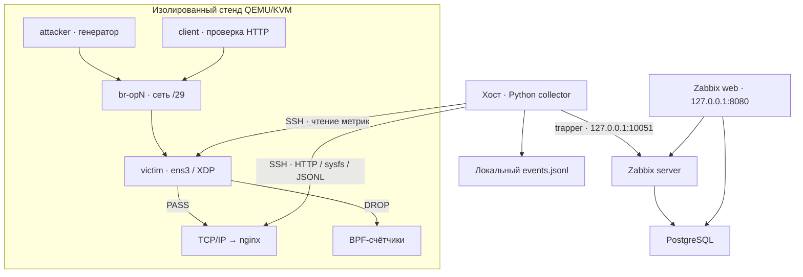

<div align="center">

# OPLA · eBPF/XDP Security Lab

**От пакета в ядре Linux до события на панели Zabbix**

Изолированный стенд QEMU/KVM · SYN rate limiting на C/eBPF · HTTP-политика nginx · автоматическая телеметрия

[Быстрый запуск](#быстрый-запуск) · [Демонстрация](#демонстрация) · [Архитектура](#архитектура) · [Результаты](#подтверждённые-результаты) · [Снапшоты](#состояние-вм-снапшоты-и-резервные-копии)

</div>

> **Статус:** локально проверенный учебный инженерный прототип. Native XDP, отбрасывание SYN, HTTP 429 и автоматическое создание объектов Zabbix подтверждены терминальными материалами. Просмотр всех виджетов, восстановление резервной копии, чистая установка и полный протокол изоляции остаются отдельными проверками. Счётчики эксперимента не являются результатом промышленного бенчмарка.

## Зачем этот проект

OPLA показывает, как связать обработку сетевых пакетов в ядре, прикладную политику и наблюдаемость в воспроизводимый эксперимент. В одной лаборатории можно проследить входящий SYN, решение XDP, состояние BPF-карты, HTTP-ответ nginx и запись метрики в Zabbix/PostgreSQL.

Вместо бесконтрольной нагрузки предусмотрены конечные сценарии с каталогом результатов: снимки счётчиков до и после, вывод генератора и код завершения. Независимая ВМ client позволяет отдельно проверить доступность сервиса. У каждого правила есть область действия, источник данных и ограничение, которое можно показать на защите работы.

Проект развивает практику анализа архитектуры безопасности Linux: виртуализация, доверенные компоненты, сетевые границы, минимизация интерфейсов управления, eBPF verifier, синхронизация BPF-карт и сопровождение телеметрии. Разработка и опыты выполнены на Debian; апробация Astra Linux SE и её механизмов МКЦ/МРД здесь не заявляется.

**Автор:** Шалашов Захар, БББО-01-23, РТУ МИРЭА. История Git сохраняет авторство отдельных изменений; автор проекта и автор каждого коммита не обязаны совпадать.

## Возможности и границы

| Область | Реализовано | Практический смысл |
|---|---|---|
| Стенд | Три ВМ, отдельный мост и /29, cloud-init, systemd units | Повторяемая топология и понятный жизненный цикл |
| Изоляция | Нет default route у ВМ; отдельные правила nftables на хосте | Ограничение маршрутизации лабораторного трафика |
| XDP | Разбор Ethernet, до двух VLAN-тегов, IPv4 и TCP | Проверка заголовков до обычной обработки TCP/IP |
| SYN | Ограничение начальных SYN по source IP и фиксированному окну | Отбрасывание превышения заданного порога |
| Фрагменты | Отбрасывание IPv4/TCP-фрагментов | Явная политика для неразбираемого TCP в этой модели |
| HTTP | nginx limit_req, таймауты, предел тела, JSON access log | Отдельный контроль прикладной интенсивности |
| Наблюдаемость | BPF-карты, sysfs, локальная HTTP-проба, журнал nginx | Несколько независимых источников состояния |
| Zabbix | 28 items, 12 triggers, 5 graphs, dashboard на трёх страницах | Автоматическая настройка через API |
| Проверки | 20 Python-тестов и проверки реального C-парсера с заглушками helpers | Быстрая проверка без запуска ВМ |
| Suricata | Три необязательных примера alert-правил | Основа для отдельного IDS-эксперимента |

**Защита UDP/ICMP/ACK-flood, ARP spoofing, SQLi/XSS и зашифрованного прикладного трафика не реализована этим XDP-фильтром.** Suricata не разворачивается автоматически, nginx rate limiting не является полноценным WAF. Проект не объединяет все уровни L2–L7 в один универсальный IPS.

## Демонстрация


**Что показано:** визуальное воспроизведение сохранённого терминального вывода пользователя от 24.10.2026. Это не запись рабочего стола и не имитация интерфейса Zabbix. Команды и результаты относятся к указанному опыту; длительность кадров выбрана для чтения и не отражает время выполнения команд.

[Видео MP4](assets/demo/terminal-replay.mp4) · [Машиночитаемые результаты и происхождение](assets/demo/observed-results.json)

Для настоящей демонстрации веб-панели нужны скриншоты текущего стенда: страницы XDP and events, HTTP protection, Interface traffic и история Problems. В этом комплекте такие изображения намеренно не подменяются нарисованным интерфейсом. Инструкция по записи находится в разделе [Собственная запись экрана](#собственная-запись-экрана).

## Содержание

- [Архитектура](#архитектура)
- [Подтверждённые результаты](#подтверждённые-результаты)
- [Требования](#требования)
- [Быстрый запуск](#быстрый-запуск)
- [Как устроен XDP-фильтр](#как-устроен-xdp-фильтр)
- [HTTP-политика nginx](#http-политика-nginx)
- [Метрики и панели Zabbix](#метрики-и-панели-zabbix)
- [Проверки и эксперименты](#проверки-и-эксперименты)
- [Suricata](#suricata)
- [Reverse proxy и защита backend](#reverse-proxy-и-защита-backend)
- [Состояние ВМ, снапшоты и резервные копии](#состояние-вм-снапшоты-и-резервные-копии)
- [Диагностика](#диагностика)
- [Собственная запись экрана](#собственная-запись-экрана)
- [Структура и публикация](#структура-и-публикация)
- [Ограничения и развитие](#ограничения-и-развитие)
- [Лицензии и первичные источники](#лицензии-и-первичные-источники)

## Архитектура



Трафик attacker → victim остаётся внутри лабораторного моста. Коллектор работает на хосте и инициирует SSH к victim; гостевой Zabbix agent для этого не требуется. Docker-сеть мониторинга отделена от моста ВМ. Метрики передаются в Zabbix server, а web читает историю и конфигурацию из PostgreSQL.

Значения IP ниже — пример первого стенда, а не жёсткие константы. При нескольких экземплярах выбирается другая свободная /29.

| Роль | IP первого стенда | Интерфейс на хосте | Интерфейс в госте |
|---|---|---|---|
| Хост | 100.64.0.1 | br-op0 | — |
| Attacker | 100.64.0.2 | op0a | ens3 |
| Victim | 100.64.0.3 | op0v | ens3 |
| Client | 100.64.0.4 | op0c | ens3 |

`br-op0` — виртуальный коммутатор, `op0v` — его TAP-порт, а `ens3` — сетевая карта внутри victim. XDP прикреплена к гостевому `ens3`; счётчик dropped на хостовом TAP не равен счётчику XDP_DROP. TX хостового `op0v` направлен к гостю, RX приходит от гостя.

### Границы доверия

Хост, QEMU, подготовленный базовый образ, ключ SSH и код коллектора входят в доверенную часть. В гостях учебная учётная запись student имеет sudo без пароля. Это сознательный компромисс стенда для воспроизводимости, а не схема разделения привилегий рабочего сервиса.

QEMU запускается от root через transient systemd units. Пользователь с доступом к Docker daemon фактически обладает широкими полномочиями на хосте. Добавление в группу docker не следует представлять как безопасный непривилегированный доступ. Компрометация этих доверенных компонентов выходит за пределы SYN rate limiter.

На хосте создаются собственные таблицы nftables конкретного стенда. Наличие правил в конфигурации не заменяет живую проверку выхода ВМ в другие сети. Для полного протокола нужно отдельно зафиксировать отсутствие default route, разрешённую связь внутри /29 и отказ выхода за её пределы.

## Подтверждённые результаты

Материалы предоставлены пользователем из локального стенда `lab-kSV4ZZai` 24 октября 2026 года. Это наблюдавшийся результат, а не повторный запуск со стороны автора README.

| Проверка | Наблюдение | Что подтверждает |
|---|---|---|
| Cloud-init | status: done на трёх ВМ | Завершение начальной настройки этого запуска |
| Загрузка C | Clang -target bpf, затем успешный attach | Сборка и принятие программы ядром этого гостя |
| XDP | ens3 driver, prog id 52, jited | Native attach и JIT в наблюдавшемся запуске |
| SYN-сценарий | Δsyn=2003, Δpass=300, Δdrop=1703 | Реальное отбрасывание учтённых SYN |
| HTTP burst | 200 запросов: 11 ответов 200, 189 ответов 429 | Срабатывание nginx rate limiting |
| HTTP-телеметрия | Δhttp_requests=201, Δhttp_limited=189 | Чтение и агрегирование прикладного журнала |
| HTTP-ошибки | Δhttp_5xx=0, Δhttp_parse_errors=0 | В данном интервале не выросли эти счётчики |
| Provisioning | 28 items, 12 triggers, 3 страницы | Успешный ответ скрипта настройки Zabbix API |
| Последующий сбор | loaded=1, mode=native, http_available=1, http_status=200 | Совместная работа источников в показанном снимке |

Разница между 200 запросами генератора и приростом 201 в журнале объяснима фоновыми запросами, включая локальную health-пробу коллектора. Не следует насильно приравнивать все агрегаты к одному генератору. Для строгой атрибуции нужны временные границы, source IP и исходный журнал.

В предыдущем опыте независимый client получил 60 ответов HTTP 200. Этот ряд относится к отдельному запуску и сам по себе не доказывает доступность во время нынешнего HTTP burst. Для итоговой демонстрации повторите пробу client одновременно с нагрузкой и сохраните её вывод.

Не подтверждены этими цифрами: максимальная пропускная способность, ускорение относительно netfilter, отсутствие ложных блокировок, устойчивость к распределённому DDoS, все виджеты web-панели и доставка внешнего уведомления. Доля 1703/2003 относится к учтённым SYN данного опыта, а не ко всем Ethernet-кадрам.

## Требования

| Компонент | Требование или наблюдавшаяся версия |
|---|---|
| Архитектура | Linux x86_64, аппаратная виртуализация, доступный /dev/kvm |
| Управление службами | systemd на хосте и пользовательский systemd для коллектора |
| ВМ | QEMU/KVM, qemu-img, cloud-localds, dnsmasq, nftables |
| Подготовка образа | libguestfs-tools, virt-customize, virt-resize, доступ к пакетным репозиториям |
| SSH | OpenSSH client, личная пара ключей id_ed25519 |
| Проверки | Python 3, PyYAML, GCC, make, Bash |
| Мониторинг | Docker Engine и Compose plugin |
| Victim | Debian 12, Clang 14.0.6, bpftool 7.1.0, libbpf 1.1.x в показанном опыте |
| Контейнеры | Zabbix 7.0.19, PostgreSQL 16.10-alpine по текущему Compose |

Конфигурация ВМ: attacker 1024 MiB/1 vCPU, victim 2048 MiB/2 vCPU, client 512 MiB/1 vCPU. Дополнительно нужна память хосту, контейнерам и браузеру. Практический ориентир для комфортной демонстрации — 8 GiB RAM или больше; это рекомендация по ресурсам, не измеренный минимальный порог.

Скрипт `bin/install-host.sh` проверяет именно Debian 12. Локальный хост пользователя содержит пакеты Debian 13; это не делает установщик универсальным для Debian 13. На другой системе сначала проверьте зависимости, не удаляйте проверку версии механически.

Образы qcow2, рабочая БД, SSH-ключи и `.env` не поставляются в исходниках. Подготовка образа требует Интернета; уже запущенный стенд проектируется без выхода гостевых систем наружу. Контейнерные теги фиксируют версии, но для побитовой воспроизводимости следует сохранить RepoDigests и контрольную сумму подготовленного qcow2.

## Быстрый запуск

Все команды make ниже выполняются **на хосте из корня репозитория**. Внутри ВМ их выполнять не нужно. Путь `~/vim/opla-ebpf-reviewed` соответствует рабочему каталогу автора опыта; у другого пользователя это каталог его checkout.

### 1. Зависимости и SSH

На чистом поддерживаемом Debian 12 сначала изучите установщик, затем выполните:

```bash
sudo ./bin/install-host.sh
```

Доступ к Docker настройте отдельно в соответствии с политикой своей машины. Проверка готовности хоста:

```bash
test -c /dev/kvm
qemu-system-x86_64 --version
python3 --version
docker compose version
docker info
```

Если ключ уже существует, используйте его. Не перезаписывайте личные ключи ради лаборатории. Если пары ключей нет, создайте её:

```bash
ssh-keygen -t ed25519
```

Задание пользовательского ключа и соответствующего public key требует согласованной настройки SSH_KEY/SSH_KEY_PUB. Закрытый ключ остаётся на хосте и никогда не копируется в репозиторий.

### 2. Подготовить образ один раз

```bash
make bootstrap
make image
```

`bootstrap` загружает базовый образ, `image` создаёт подготовленный образ с пакетами. Скрипт не перезаписывает существующий `images/debian-12-xdp.qcow2`, чтобы не менять backing file работающих ВМ.

Если используется старый подготовленный образ, проверьте наличие nginx и остальных пакетов. Ранее отсутствие nginx приводило к ошибке cloud-init. Для изменения qcow2 сначала завершите все использующие его ВМ; не запускайте virt-customize на backing file работающего стенда.

### 3. Создать один экземпляр и дождаться SSH

```bash
make up
export LAB_DIR="$(python3 bin/state.py --latest)"
printf '%s\n' "$LAB_DIR"
```

`make up` каждый раз создаёт новый стенд. Эта команда не означает «продолжить загрузку предыдущего». При ошибке первого `make ready` не запускайте снова `make up`.

```bash
ready=0
for attempt in {1..12}; do
  if make ready; then
    ready=1
    break
  fi
  echo 'Ожидание SSH: следующая попытка через 5 секунд'
  sleep 5
done
[ "$ready" -eq 1 ]
```

Ошибка подключения в первые секунды может быть обычной задержкой загрузки. `cloud-init status: error` — уже другой случай: нужно изучить guest log, а не бесконечно повторять ожидание. Интервал выше не является жёстким общим таймаутом: cloud-init --wait внутри одной попытки может ждать дольше.

### 4. Проверить и загрузить XDP

```bash
make check &&
make versions &&
make xdp-all THRESHOLD=100 &&
make xdp-stats
```

Для свежего стенда ожидается `loaded: 1` и `mode: native`, если драйвер поддерживает native XDP. Generic fallback допустим только при невозможности привязки драйвера. Ожидаемый режим конкретного опыта фиксируется в отчёте.

При уже подключённой программе загрузчик останавливается. Чтобы намеренно заменить фильтр:

```bash
make xdp-unload &&
make xdp-all THRESHOLD=100 &&
make xdp-stats
```

В промежутке между unload и load XDP-защита отсутствует. Новая компиляция без успешной загрузки не меняет работающий порог. Не смешивайте статистику до и после перезагрузки карт: накопительные счётчики могут сброситься.

### 5. Поднять мониторинг и HTTP-политику

```bash
make monitoring-up
```

Откройте `http://127.0.0.1:8080/`, дождитесь готовности Zabbix и смените начальный пароль Admin/zabbix. Затем:

```bash
bash bin/observability-up.sh
```

Сценарий останавливает старый коллектор выбранного стенда, устанавливает nginx-конфигурацию с проверкой `nginx -t`, копирует сборщик, запрашивает учётные данные API, создаёт объекты Zabbix и запускает пользовательскую службу. Пароль API вводится интерактивно; пароль БД генерируется в `monitoring/.env`.

### 6. Провести конечные сценарии

```bash
bash bin/traffic-scenario.sh syn &&
bash bin/security-http-test.sh
```

Проверьте сохранённые каталоги `reports/scenario-*`, затем откройте Zabbix dashboard текущего узла. Для client используйте адрес victim из state.env, а не IP из чужого отчёта. Работая с несколькими экземплярами, сохраняйте LAB_DIR явно для всех команд.

### 7. Завершить демонстрацию

```bash
make monitoring-stop
```

Перед удалением стенда сохраните необходимые результаты и резервные копии. Только после этого:

```bash
make down
make monitoring-down
```

`make down` удаляет рабочие диски выбранного экземпляра. Это очистка лаборатории, а не безопасная кнопка pause. `monitoring-down` сохраняет Docker volume PostgreSQL; команда с `down -v` имеет другой смысл и здесь не требуется.

## Как устроен XDP-фильтр

Исходник — `xdp/xdp_ddos_protect.c`. Пакет проходит проверки Ethernet/VLAN, минимальной длины IPv4, версии, IHL, протокола и длины TCP. Данные за пределами доступного пакета не читаются. Программа разбирает до двух VLAN-тегов; это поддержка формата, а не контроль принадлежности VLAN.

Для IPv4 TCP-фрагментов действует отдельное правило DROP. Для начального TCP SYN (`SYN=1`, `ACK=0`) определяется source IP и состояние фиксированного окна. Первые THRESHOLD пакетов окна проходят, последующие отбрасываются. По умолчанию окно составляет одну секунду, порог — 100 SYN на source IP.

Лимит распространяется на все TCP-порты, включая SSH. Несколько пользователей за одним NAT делят лимит одного IP. Подмена множества source IP и распределённая нагрузка не решаются простым per-IP ограничением. У фиксированного окна возможен повышенный всплеск около границы двух окон.

### Карты и синхронизация

| Карта | Тип | Ключ / значение | Назначение |
|---|---|---|---|
| syn_windows | hash, до 1024 записей | IPv4 / spin lock, count, start_ns | Состояние окна каждого source IP |
| xdp_stats | per-CPU array, 5 записей | индекс / u64 на CPU | Накопительные счётчики решений |

Spin lock защищает совместное изменение окна и счётчика. Карта адресов не имеет автоматического старения: заполнение старых записей — известное ограничение. При отказе добавления нового адреса соответствующий SYN отбрасывается и учитывается в map_full.

Значения per-CPU нужно суммировать. Один CPU с нулём не означает отсутствие работы программы; значение может находиться на другом CPU. start_ns — монотонное время ядра, его нельзя напрямую интерпретировать как календарную дату.

| Индекс xdp_stats | Имя | Смысл |
|---|---|---|
| 0 | syn | Учтённые начальные SYN |
| 1 | pass | Пропущенные учтённые SYN |
| 2 | drop | Отброшенные учтённые SYN |
| 3 | map_full | SYN, отклонённые при отказе добавления адреса |
| 4 | fragment_drop | Отброшенные IPv4/TCP-фрагменты |

`pass` не означает «весь разрешённый сетевой трафик». UDP, ICMP и TCP ACK без начального SYN не увеличивают этот счётчик. Отдельные ошибки разбора также могут завершаться DROP без роста SYN-drop. Интерпретация счётчиков привязана к коду, а не к названию виджета.

### Исправление verifier

Ранее загрузка завершалась отказом при вычислении указателя `(void *)ip + total`: verifier не смог доказать безопасную нижнюю границу scalar после преобразования длины. Исправление сравнивает длины, не прибавляя total к packet pointer:

```c
__u64 available = (char *)end - (char *)ip;
if (total < ihl + sizeof(struct tcphdr) || total > available)
    return XDP_DROP;
```

Успешный C-тест с подменёнными helpers не доказывает принятие verifier. В этом проекте отдельно показаны и переносимые тесты, и успешная загрузка в реальное ядро victim. Наличие BTF в объекте не означает применение CO-RE.

### Проверка внутри victim

```bash
make ssh VM=victim
sudo ip -details link show dev ens3
sudo bpftool net show
sudo bpftool prog show pinned /sys/fs/bpf/opla/program
sudo bpftool -p map dump pinned /sys/fs/bpf/opla/maps/xdp_stats
sudo bpftool -p map dump pinned /sys/fs/bpf/opla/maps/syn_windows
exit
```

Программа закреплена в `/sys/fs/bpf/opla/program`; карты — в `/sys/fs/bpf/opla/maps/`. ID программы и карт меняются после загрузок, поэтому в скриптах используются pinned paths. trace_pipe ничего не обязан показывать: отладочная печать в программе не включена.

## HTTP-политика nginx

Файл `security/nginx/opla-l7.conf` предназначен для стандартного Debian nginx, включающего conf.d в контекст http. В учебном victim nginx обслуживает тестовую страницу. Это отдельный nginx, не web-сервер Zabbix-контейнера.

| Параметр | Значение | Назначение |
|---|---|---|
| Ключ лимита | binary_remote_addr | Адрес реального TCP-клиента |
| Интенсивность | 5 запросов/с на IP | Ограничение запросов |
| Burst | 10, nodelay | Допустимый кратковременный всплеск |
| Код отклонения | 429 | Отличие политики от ошибки приложения |
| Таймауты | 10 секунд | Ограничение ожиданий в заданных фазах |
| Тело запроса | 1 MiB | Верхняя граница размера тела |
| Журнал | opla-security.jsonl | Структурированные HTTP-записи |

Это не правило «разрешить ровно 5 запросов в любую секунду»: алгоритм nginx и burst отличаются от фиксированного окна C-фильтра. Таймауты также не равны универсальному пределу полной длительности запроса. Политика не анализирует SQLi/XSS и не заменяет авторизацию приложения.

Применение и удаление выполняются на хосте:

```bash
bash bin/security-http.sh apply
# Для намеренного отключения HTTP-политики:
# bash bin/security-http.sh remove
```

Скрипт проверяет nginx-конфигурацию перед reload. Если пользовательские server/location переопределяют директивы, наследование нужно проверить отдельно через `nginx -T`. Успешное чтение старого журнала ещё не доказывает, что актуальная политика всё ещё установлена.

Локальная HTTP-проба коллектора идёт к loopback victim и создаёт собственные запросы. Её доступность не равна доступности сервиса из client. XDP на ens3 не обрабатывает эту loopback-пробу; end-to-end проверка должна приходить с отдельной ВМ.

## Метрики и панели Zabbix

Единый каталог — `monitoring/catalog.py`; настройка — `monitoring/setup.py`; сбор — `monitoring/bridge.py` и гостевой `xdp/collect.py`. Скрипт upsert создаёт отсутствующие items и исправляет управляемые существующие без обязательного пересоздания их ID. Названия и структура управляемой панели могут обновляться повторным запуском.

Настройка выделяет собственную группу OPLA Lab и узел вида `opla-lab-XXXXXXXX`. При повторном создании лаборатории получается новый узел; история старого не становится автоматически историей нового. Пользовательский dashboard лучше копировать перед ручной переработкой, если он не должен перезаписываться настройщиком.

### Все 18 исходных элементов

| Ключ Zabbix | Тип / единица | Источник и смысл |
|---|---|---|
| xdp.loaded | unsigned, 0/1 | Ожидаемая программа подключена к ens3 |
| xdp.mode | character | native, generic или off |
| xdp.syn | unsigned | Начальные SYN |
| xdp.pass | unsigned | Пропущенные учтённые SYN |
| xdp.drop | unsigned | Отброшенные учтённые SYN |
| xdp.map_full | unsigned | Отказы новых адресов при заполнении карты |
| xdp.fragment_drop | unsigned | IPv4/TCP-фрагменты |
| xdp.events | log | События интервала, сформированные коллектором |
| net.rx_packets | unsigned | RX packets ens3 из sysfs |
| net.rx_bytes | unsigned, B | RX bytes ens3 из sysfs |
| http.available | unsigned, 0/1 | Читается HTTP JSON log |
| http.requests | unsigned | Запросы, учтённые по журналу |
| http.limited | unsigned | Записи с limit_req=REJECTED |
| http.errors5xx | unsigned | Ответы 5xx в журнале |
| http.parse_errors | unsigned | Некорректные записи HTTP-телеметрии |
| http.up | unsigned, 0/1 | Локальная HTTP-проба получила 200 |
| http.status | unsigned | Код HTTP-пробы, 0 при ошибке транспорта |
| http.latency | unsigned, us | Длительность локальной пробы |

### Ещё 10 зависимых элементов

Скорости рассчитываются preprocessing Change per second по накопительным исходным значениям. Это дополнительные элементы Zabbix, а не дополнительные BPF-программы или сетевые интерфейсы.

| Ключ | Единица |
|---|---|
| xdp.syn.rate | SYN/с |
| xdp.pass.rate | SYN/с |
| xdp.drop.rate | SYN/с |
| xdp.map_full.rate | событий/с |
| xdp.fragment_drop.rate | фрагментов/с |
| net.rx_packets.rate | пакетов/с |
| net.rx_bytes.rate | B/с |
| http.requests.rate | запросов/с |
| http.limited.rate | отклонений/с |
| http.errors5xx.rate | ошибок/с |

После сброса исходного счётчика или первой передачи скорость может не появиться немедленно. Это требует двух согласованных значений и не означает отсутствия самого item. sysfs RX и BPF-счётчики имеют разную область учёта; их равенство не является критерием правильности.

### Навигация в web

1. **Dashboards:** выберите панель текущего узла. Страницы: XDP and events, HTTP protection, Interface traffic.
2. **Monitoring → Latest data:** выберите host, расширьте интервал и проверьте время последнего значения.
3. **Data collection → Hosts → Items:** проверьте keys, тип, status, ошибки и master item зависимых метрик.
4. **Monitoring → Problems:** смотрите текущие и недавние проблемы; при отсутствии текущей проблемы откройте историю.
5. **Alerts → Trigger actions:** настройка доставки внешнего сообщения, если она нужна отдельно.

`XDP attached=1` — один булев индикатор состояния одной привязки. Он не должен показывать число всех метрик. Полная картина находится на остальных tiles, графиках и страницах. Если вы видите только этот элемент, проверьте выбранную панель, host и успешность provisioning.

В настройке предусмотрено 12 условий: состояние XDP, отсутствие данных, отбрасывания, заполнение карты, фрагменты, высокий SYN с отбрасываниями, недоступность HTTP-журнала, HTTP limiting, 5xx, ошибки разбора, отказ HTTP-пробы и повышенная задержка. Точные выражения и пороги проверяйте в setup.py и policy.json. Эти пороги уведомления не меняют THRESHOLD C-фильтра или rate nginx.

### Сбор, журналы и БД

Коллектор периодически получает полный снимок по SSH, пишет JSONL и отправляет значения trapper-протоколом. Ответ sender проверяется на частичные отказы. Локальный журнал содержит снимки/события интервала, а не гарантированную запись каждого отдельного пакета.

```bash
export LAB_DIR="$(python3 bin/state.py --latest)"
systemctl --user status "opla-monitor-${LAB_DIR##*/}.service" --no-pager -l
journalctl --user -u "opla-monitor-${LAB_DIR##*/}.service" -n 40 --no-pager
tail -n 5 "monitoring/runtime/${LAB_DIR##*/}/events.jsonl"
```

В journal обычно выводятся ошибки; отсутствие потока успешных сообщений не является отказом. Проверяйте свежесть JSONL и Latest data. Диагностику с пробной отправкой выполняйте после остановки фонового коллектора, чтобы не конкурировать за lock:

```bash
make monitoring-stop
python3 monitoring/diagnose.py --lab "$LAB_DIR"
make monitoring-start
```

Просмотр SQL выполняется read-only запросами из monitoring/sql через psql внутри контейнера. Числовые unsigned лежат в history_uint, зависимые float — history, события Log — history_log; имена конкретных таблиц не означают, что туда нужно вручную вставлять метрики.

```bash
docker exec -i opla-monitoring-db-1 psql -U zabbix -d zabbix \
  -v "host_name=opla-${LAB_DIR##*/}" < monitoring/sql/inspect.sql
```

Проверьте параметры и условия SQL-файла перед выполнением. Не запускайте массовые запросы ко всей истории без временной границы. Полный дамп БД содержит данные конфигурации и пользователей и не предназначен для публичного репозитория.

Очередь неотправленных событий находится в памяти, имеет ограничение и не гарантирует восстановление после перезапуска. Локальная ротация JSONL хранит ограниченный объём. Коллектор HTTP обрабатывает ротацию по inode/offset, но непрочитанный хвост старого файла может потеряться. Это ограничения надёжности, а не криптографически защищённый аудит.

## Проверки и эксперименты

### Что делает make check

```bash
make check
```

Проверяются синтаксис shell/Python, чтение YAML, агрегация per-CPU, декодирование больших u64, распознавание привязки нужной программы, framing sender и частичный отказ отправки. Проверки provisioning контролируют идемпотентность items, полноту dashboard и отсутствие пересечения tiles. HTTP-тесты проверяют incremental read, частичную строку, повреждённую запись, ротацию и явную недоступность источника.

C harness использует настоящий парсер xdp_ddos_protect.c с подменёнными helpers и временем. Проверяются порог, граница окна, ACK, заполнение карты, усечения, IHL, TCP length, фрагменты, VLAN и область IPv6. Это не проверка поведения spin lock в реальной многопроцессорной нагрузке.

Локальный результат: 20 Python-тестов проходят; C-проверки проходят. Не входят в make check: KVM, native драйвер, verifier, контейнеры Zabbix, живые виджеты и nginx. Для каждого из них нужен отдельный интеграционный шаг.

### Матрица конечных сценариев

| Команда на хосте | Ожидаемая интерпретация |
|---|---|
| bash bin/traffic-scenario.sh syn | При превышении порога растут SYN drop и соответствующая скорость |
| bash bin/traffic-scenario.sh ack | ACK без SYN не должен блокироваться правилом SYN |
| bash bin/traffic-scenario.sh udp | Контроль области действия: UDP rate limiter здесь отсутствует |
| bash bin/traffic-scenario.sh icmp | Контроль области действия: ICMP rate limiter здесь отсутствует |
| bash bin/traffic-scenario.sh http | Конечные HTTP-запросы и наблюдение доступности |
| bash bin/security-http-test.sh | Burst по keep-alive; ожидаются HTTP 429 и рост http.limited |

ACK/UDP/ICMP в данном комплекте — контрольные сценарии границ, а не обещание защиты от этих flood. Код завершения генератора 0 означает завершение программы, но не доказывает доставку каждого пакета или ожидаемое решение защиты.

Процент packet loss в hping не равен XDP_DROP. UDP на закрытый порт может получать ограниченные ICMP-ответы, а ответ SYN-ACK не равен успешно выполненному HTTP-запросу. Для вывода сопоставляйте собственные счётчики, ответ сервиса, время и направление трафика.

### Независимый client во время нагрузки

В отдельном терминале на хосте откройте client:

```bash
make ssh VM=client
```

Внутри client для первого стенда:

```bash
for i in $(seq 1 60); do
  printf '%s ' "$(date -Is)"
  curl --max-time 3 -sS -o /dev/null \
    -w 'HTTP=%{http_code} time=%{time_total}s\n' http://100.64.0.3/
  sleep 1
done
exit
```

Запустите конечный сценарий attacker параллельно в другом хостовом окне. Запишите вывод client, время начала/конца и адрес victim. IP 100.64.0.3 заменяется значением вашего выбранного стенда; при нескольких экземплярах он может отличаться.

### Что сохранять как доказательство

Для каждого опыта фиксируйте commit, git diff/status, LAB_ID, время с timezone, параметры сборки, режим attach, before/after JSON, stdout/stderr генератора, HTTP-вывод client и временной интервал Zabbix. Если источники изменены без commit, один git rev-parse HEAD не идентифицирует реально запущенный код.

Дополнительно полезны версии kernel/QEMU/Clang/libbpf, digest контейнеров и sha256 подготовленного образа. Контрольную сумму qcow2 снимайте, когда файл не меняется; копирование активного overlay для отчёта не делает его корректным checkpoint.

## Suricata

Suricata добавлена как необязательный путь исследования IDS при расширении работы за пределы SYN. Это отдельный движок анализа, не модуль eBPF и не обязательная зависимость действующего стенда. Автоматическая установка, capture-служба, настройка HOME_NET и доставка EVE в Zabbix пока не реализованы.

В репозитории находятся **локальные правила**, а не скачанные бинарные модули:

```text
security/suricata/opla.rules
```

| SID | Пример обнаружения | Действие |
|---|---|---|
| 9001001 | Высокая интенсивность SYN одного источника | alert |
| 9001002 | Высокая интенсивность UDP одного источника | alert |
| 9001003 | Высокая интенсивность HTTP GET | alert |

Все три используют detection_filter и формируют alert после порогового условия. Замена слова alert на drop сама по себе не создаёт корректный rate limiter: важны IPS-режим, поток трафика, семантика правила и возможные ложные блокировки.

Чтобы узнать, установлен ли движок на конкретной машине, выполните именно на ней:

```bash
command -v suricata
command -v suricata-update
dpkg-query -W suricata suricata-update 2>/dev/null
```

Для отдельно установленной Suricata типичные места: `/etc/suricata/suricata.yaml` — конфигурация, `/var/lib/suricata/rules/suricata.rules` — объединённый ruleset suricata-update, `/var/log/suricata/eve.json` — события. Фактические пути определяет конфигурация установки. Отсутствие этих файлов в OPLA не означает, что их нужно искать в BPF-картах.

HOME_NET для текущего первого стенда должен явно включать 100.64.0.0/29: этот диапазон не входит в обычные RFC1918-подсети. На другом экземпляре используйте SUBNET из его state.env. Перед запуском движка проверьте конфигурацию и правила через suricata -T. Не направляйте скачанные правила в Интернет из изолированной guest-сети: подготовка выполняется заранее или на отдельном сенсоре.

Для следующего этапа предпочтителен пассивный сенсор на хостовом порту victim `op0v` или отдельное зеркалирование. Нужно зафиксировать обе стороны обмена, дубли, offload и нагрузку capture. На гостевом ens3 пакеты, уже отброшенные native XDP, до обычного capture не доходят; отсутствие IDS-alert там не доказывает отсутствия атаки.

Алерты Suricata нельзя автоматически считать событиями текущего dashboard: для этого требуется отдельный parser/shipper, keys/items, тесты и сохранённые EVE-примеры. На публичной странице проекта этот раздел остаётся расширением, пока такая цепочка не апробирована.

## Reverse proxy и защита backend

Нужно различать две плоскости: тестируемый HTTP-сервис victim и административный web-интерфейс Zabbix. Размещение Zabbix за атакуемым nginx victim смешало бы управление с объектом эксперимента. Эти компоненты сохраняются раздельными.

Сейчас Compose публикует Zabbix web и trapper только на 127.0.0.1 хоста. PostgreSQL не имеет ports на хосте. Надпись `5432/tcp` в docker ps означает порт контейнера, а не `0.0.0.0:5432` хоста. Это полезная исходная граница, но не запрет доступа из всех контейнеров той же сети.

| Поток | Текущее решение | Когда нужен отдельный proxy |
|---|---|---|
| Браузер хоста → Zabbix web | localhost:8080 | Не обязателен для локальной демонстрации |
| Удалённый администратор → Zabbix | По умолчанию не опубликован в LAN | VPN/SSH-туннель; при публикации отдельный HTTPS entrypoint |
| Коллектор → Zabbix trapper | localhost:10051, собственный протокол | HTTP reverse proxy сюда не подходит |
| Zabbix/web → PostgreSQL | Внутренняя Docker-сеть | БД обычно остаётся внутренней без HTTP-прокси |
| Attacker/client → victim nginx | HTTP внутри /29 | Proxy появляется при добавлении отдельного приложения backend |

Для удалённого доступа к панели можно использовать SSH-туннель к хосту вместо открытия web наружу. Если нужен общий web-entrypoint, отдельно проектируются TLS, разрешённые сети, авторизация, лимиты, заголовки и журнал. В nginx HTTP proxy_pass работает с HTTP upstream, а PostgreSQL использует другой протокол; stream TCP proxy не заменяет роли БД, TLS и сегментацию.

Добавление reverse proxy само по себе не устраняет уязвимости backend. Нельзя доверять произвольному X-Forwarded-For как реальному IP клиента: иначе обходятся per-IP лимиты. При доверенном proxy список его адресов и real_ip-политика должны быть явными. Иначе все запросы могут ошибочно учитываться под адресом proxy.

Для данной локальной версии новый административный proxy не включён автоматически. Это сохраняет уже проверяемую схему и не создаёт ещё один непроверенный сервис. Более сильное разделение Docker-сетей frontend/backend возможно отдельным изменением с проверкой соединений и healthchecks.

## Состояние ВМ, снапшоты и резервные копии

### Три разных уровня сохранения

| Объект | Где находится | Что сохраняет |
|---|---|---|
| Исходники | Git | Код, конфигурацию и историю изменений |
| Backing image | images/debian-12-xdp.qcow2 | Подготовленную гостевую систему до опыта |
| Рабочий overlay | /var/lib/opla/lab-*/VM/disk.qcow2 | Изменения диска конкретной ВМ |
| VM snapshot | Только после добавления monitor/QMP | Диск, RAM, CPU и устройства в пределах поддержки QEMU |
| Мониторинг | Docker volume PostgreSQL + runtime на хосте | Историю Zabbix и локальные события |

`debian-12-xdp.before-nginx.qcow2` — обычная ранее созданная копия образа. Имя файла не делает её live-снапшотом и не подтверждает наличие памяти работающей ВМ. Git commit также не сохраняет состояние гостевой ОС.

### Что доступно сейчас

QEMU запускается с `-monitor none`, без QMP-сокета. Поэтому `savevm` для уже запущенного процесса недоступен через текущие скрипты. Serial console — терминал гостевой ОС, а не QEMU monitor. Ввод savevm в shell victim не создаёт снапшот.

Не используйте `qemu-img snapshot -c` для работающего диска и не снимайте его обычным cp как гарантированно согласованную копию. QEMU предупреждает, что изменение используемого образа через qemu-img может его разрушить. Блокировки файла не нужно обходить флагом force-share ради резервирования.

### Практический путь: холодная копия дисков

Для текущей версии понятнее сначала получить согласованную дисковую копию с коротким простоем. **Не выполняйте make down перед копированием:** он удаляет overlay. Сначала сохраните reports/runtime, остановите коллектор и корректно выключите гостевые ОС через shutdown, затем убедитесь, что QEMU-процессы завершились.

На хосте закрепите выбранный экземпляр:

```bash
export LAB_DIR="$(python3 bin/state.py --latest)"
lab_id="${LAB_DIR##*/}"
make monitoring-stop
```

В каждую ВМ зайдите по SSH и выполните `sudo shutdown -h now`. После этого на хосте проверьте статус всех трёх служб:

```bash
sudo systemctl show \
  "qemu-${lab_id}-attacker.service" \
  "qemu-${lab_id}-victim.service" \
  "qemu-${lab_id}-client.service" \
  -p Id -p ActiveState -p SubState -p MainPID
```

Продолжайте только после завершения всех QEMU, работающих с выбранными дисками. Обычный systemctl stop не гарантирует корректного завершения гостевой ФС; используйте гостевой shutdown. Запись ниже создаёт самостоятельные qcow2 без ссылки на исходный backing file:

```bash
backup_dir="$HOME/opla-backups/${lab_id}-$(date +%Y%m%d-%H%M%S)"
mkdir -p "$backup_dir"
chmod 700 "$backup_dir"
for vm in attacker victim client; do
  sudo qemu-img convert -p -f qcow2 -O qcow2 \
    "$LAB_DIR/$vm/disk.qcow2" "$backup_dir/$vm.qcow2" || break
done
```

Для каждого успешно созданного файла проверьте `qemu-img info --backing-chain` и `qemu-img check`, сохраните sha256. Дополнительно скопируйте state.env, seed ISO и версии, если нужен разбор опыта. Такая копия не включает RAM, runtime BPF-карты, сеть хоста или PostgreSQL. Автоматическое восстановление в новый экземпляр текущими make-целями не реализовано; до проверки boot/SSH/данных это резервная копия-кандидат, а не доказанное восстановление.

### Настоящие VM snapshots следующего этапа

Для новых запусков можно добавить защищённый локальный QMP/HMP Unix socket, доступный только администратору. После отдельной проверки QEMU monitor поддерживает `savevm`, `info snapshots`, `loadvm`, `delvm`. Эти операции нельзя выдавать за уже существующие make-цели проекта.

Полный VM snapshot включает RAM/CPU/device state и writable disks в пределах поддерживаемых устройств. Он может кратковременно приостанавливать ВМ. Совместимость зависит от версии QEMU и виртуальных устройств; поддержку virtio-net и активного XDP нужно проверить живым save/restore. Это не атомарный распределённый снимок трёх ВМ.

Откат victim способен вернуть состояние ядра и счётчиков назад, а PostgreSQL продолжит хранить более новую историю. После restore нужны метка эпохи/событие сброса и проверка collector cursor. Восстановление одной машины не восстанавливает уже установленные TCP-соединения со всеми остальными участниками.

Для долгого хранения предпочтительны самостоятельные дисковые копии и проверяемый restore; внутренний snapshot внутри того же qcow2 не защищает от потери самого файла. Доступ к monitor равнозначен сильным полномочиям над ВМ, поэтому TCP monitor на 0.0.0.0 здесь не нужен.

### PostgreSQL отдельно

Резервная копия ВМ не включает БД контейнера. Пока контейнер работает, логический дамп можно снять штатным pg_dump, не копированием его live volume:

```bash
backup_db="$HOME/opla-backups/db-$(date +%Y%m%d-%H%M%S)"
mkdir -p "$backup_db"
chmod 700 "$backup_db"
(umask 077; docker exec opla-monitoring-db-1 \
  pg_dump -U zabbix -d zabbix -Fc > "$backup_db/zabbix.dump")
```

pg_dump даёт согласованный снимок содержимого одной БД в момент транзакции, но не одновременно с тремя ВМ и не все cluster roles. Проверяйте код завершения; затем список архива через pg_restore -l и тестовое восстановление в отдельную БД. Дамп, `.env` и секреты сохраняются приватно, вне Git.

## Диагностика

| Симптом | Сначала проверить |
|---|---|
| make: No rule to make target | Вы находитесь в корне checkout, а не reports/images/guest |
| Нет активного стенда | LAB_DIR и наличие state.env; make versions требует ВМ |
| No route / Connection refused после up | Загрузку ВМ; повторить ready, не создавать ещё один стенд |
| cloud-init status: error | /var/log/cloud-init-output.log и cloud-final.service внутри гостя |
| На ens3 уже есть XDP | Намеренно unload перед заменой, сохранить старые счётчики |
| loaded=0 | Attach, pinned path, нужный prog id и результат verifier |
| HTTP 200 есть, http.available=0 | Применена ли JSON-log конфигурация, существует ли новый журнал |
| processed меньше total | Типы/keys/items, host name, разрешённые senders, актуальный provisioning |
| Только XDP attached | Выбран ли правильный dashboard/host, создан ли полный каталог |
| journal показывает только Started | Свежесть events.jsonl и Latest data, а не число сообщений stdout |
| bridge: command not found | /usr/sbin/bridge и пользовательский PATH |
| Обычный ps не видит QEMU | sudo ps и systemctl status; ограничения видимости /proc |
| map_full=0, fragment_drop=0 | Нулевое значение не доказывает отдельную апробацию этих ветвей |

### Процессы и сетевые порты

На хосте:

```bash
ip -br address
ip route
ip link show master br-op0
sudo /usr/sbin/bridge link show
sudo ps -ww -eo pid,ppid,user,args | grep '[q]emu-system'
sudo ss -lntup
docker network ls --no-trunc
docker ps --format 'table {{.Names}}\t{{.Ports}}\t{{.Status}}'
```

В аргументах QEMU `ifname=op0v` прямо связывает PID с TAP victim. `master br-op0` связывает порт с мостом. `ip route get 100.64.0.3` показывает выбор маршрута с хоста, но не доказывает правила маршрутизации гостя.

Для просмотра ресурсов используйте `sudo systemd-cgtop` и `docker stats`. Процент CPU может превышать 100% при учёте нескольких CPU; значения родительской cgroup включают дочерние, их нельзя суммировать как независимые процессы. NET I/O и BLOCK I/O в docker stats — накопленные объёмы, а не мгновенные скорости.

В guest-командах ss nginx показывает master и несколько workers около одного слушающего порта. Это обычное разделение управления и обработки запросов. Контейнер Zabbix web содержит собственные nginx/PHP-FPM и не является nginx victim.

### Наблюдение пакетов

Для capture на хостовом порту victim можно использовать tcpdump с конечным числом пакетов:

```bash
sudo tcpdump -ni op0v -c 100 'host 100.64.0.3 and tcp port 80'
```

Запускать только для выбранного стенда и сохранять pcap приватно, если он содержит прикладные данные. Наличие пакета на хостовом TAP не означает его пропуск гостевой XDP. На victim пакет после native XDP_DROP обычно не будет виден обычному tcpdump.

Сравнение PCAP, map counters и HTTP-журнала полезнее одного показателя packet loss. Для pps, задержек и нагрузки CPU фиксируйте длительность, источник времени и метод измерения. Не сравнивайте скриншот произвольного пика с усреднённым графиком как равные величины.

## Собственная запись экрана

Встроенная GIF/MP4 демонстрация — replay сохранённого текста. Для портфолио её стоит дополнить короткой реальной записью панели и терминала одного запуска. Скриншот должен показывать проверяемое состояние, а не заполненный случайными данными dashboard.

Рекомендуемый набор:

| Файл для будущей записи | Содержание |
|---|---|
| assets/demo/zabbix-xdp.png | Узел, loaded/mode, SYN pass/drop и скорость |
| assets/demo/zabbix-http.png | requests, limited, доступность и задержка |
| assets/demo/zabbix-problems.png | Проблема с временем и последующее восстановление |
| assets/demo/live-demo.mp4 | Конечный сценарий и независимый client |

Эти четыре файла не поставляются как готовые скриншоты в данном пакете. После записи добавьте их ссылки в README. Используйте OBS Studio, системный recorder Wayland/GNOME или другой доступный инструмент. Не включайте пароли API, `.env`, личные вкладки, ключи и чужие данные.

План записи на 60–90 секунд: показать LAB_ID и native attach; вывести исходные счётчики; запустить SYN-сценарий; показать рост drop; запустить HTTP burst; показать 429 и http.limited; закончить ответом 200 от независимого client после опыта. Свежесть и единый временной интервал важнее длинной непрерывной записи.

Исходное видео храните вне Git. Короткую web-версию можно подготовить ffmpeg:

```bash
ffmpeg -i /path/to/recording.mp4 -an \
  -vf 'scale=1280:-2:flags=lanczos,fps=15' \
  -c:v libx264 -crf 25 -pix_fmt yuv420p -movflags +faststart \
  assets/demo/live-demo.mp4
```

Путь `/path/to/recording.mp4` заменяется существующим локальным файлом. Для GIF отберите короткий фрагмент, уменьшите размер и частоту кадров; не превращайте многочасовую запись в огромный Git blob. Скриншоты лучше сохранять в PNG, видео — H.264 MP4 без звука, если речь не нужна.

В GitHub/GitLab относительная ссылка на MP4 может открывать файл, а не встроенный player: поведение зависит от площадки. Для просмотра прямо на странице используйте поддерживаемое размещение видео площадки или release asset. GIF отображается обычным Markdown image. Не добавляйте CI badge до появления реального remote и успешного workflow.

## Структура и публикация

```text
bin/                 создание стенда, SSH, версии, сценарии
cloud-init/          начальная конфигурация трёх ВМ
xdp/                 C-фильтр, build/load и гостевой collector
monitoring/          Compose, API provisioning, bridge, SQL
security/nginx/      HTTP-политика тестового victim
security/suricata/   необязательные alert-правила
tests/               переносимые проверки и C harness
assets/demo/         компактный replay результатов и будущие live-медиа
images/              локальные образы, вне Git
reports/             локальные результаты, вне Git
```

Корневой README содержит самостоятельное описание проекта, запуска, архитектуры, метрик, опытов и ограничений. Отдельные учебные методички и печатные документы могут храниться вне публичной версии. Удаление docs из нового commit не стирает файлы из прежней истории Git.

Рабочий репозиторий сохраняет две линии истории: исходный проект и восстановленный review-снимок, объединённые merge commit. Результат `git log --all` показывает обе линии; это не два одновременно запущенных стенда. Ветки — указатели на коммиты, а не каталоги с ВМ.

Изменения `!26 ?21` ещё не входят в HEAD: первая часть обозначает изменённые отслеживаемые файлы, вторая — неотслеживаемые по правилам используемой темы prompt. Окончательный список проверяйте `git status --short`; числа prompt не заменяют просмотр diff.

### Публичный состав

В исходники включаются C/Python/Bash, конфигурации без секретов, tests, workflow, LICENSE, README и небольшие media. Не включаются qcow2, дамп PostgreSQL, monitoring/.env, known_hosts рабочего стенда, private keys, runtime, полные access logs и необработанные отчёты с личными данными.

.gitignore предотвращает новое добавление совпадающих файлов, но не прекращает отслеживание уже закоммиченных PDF/DOCX. Для исключения старых печатных документов из текущего дерева используется `git rm --cached`, предварительно проверив список. Прежние версии всё равно останутся в истории; это нужно учитывать при публичном push всех прежних коммитов.

Для публикации без учебной документации безопаснее отдельная release-ветка/worktree: рабочий экземпляр с образом и LAB_DIR не перемещается, исходная история не переписывается, docs исключаются только из дерева публикационной ветки. Создание чистой новой публичной истории — отдельное решение, а не скрытое действие этого комплекта.

Перед push выполните `make check`, `git diff --check`, просмотрите staged diff и `git remote -v`. Старый origin может указывать на review.bundle, а не на сетевой репозиторий. Реальный URL GitHub/GitLab должен задать владелец. Внешняя публикация не считается выполненной только потому, что архив подготовлен.

### Представление в портфолио

Краткая формулировка: «Разработал учебный Linux-стенд QEMU/KVM с per-IP SYN limiter на eBPF/XDP, HTTP rate limiting nginx и автоматическим provisioning Zabbix. Проверил native attach, отбрасывание SYN и HTTP 429; реализовал сбор BPF/sysfs/HTTP-метрик и переносимые тесты».

На собеседовании полезно разобрать один полный путь пакета, причину verifier fix, выбор spin lock, ограничения фиксированного окна, сохранность телеметрии и отличия локальной health-пробы от end-to-end client. Это конкретнее, чем заявлять «защита от всех атак L2–L7».

## Ограничения и развитие

| Направление | Текущее состояние | Следующая проверяемая задача |
|---|---|---|
| Развёртывание | Локальный запуск подтверждён | Чистый Debian 12 и полный приёмочный протокол |
| Dashboard | API создал объекты | Визуальная проверка всех страниц и типов виджетов |
| Уведомления | Триггеры настроены | Отдельная action/media и реальная доставка/recovery |
| Карта source IP | 1024 записи без aging | Очистка/aging, сценарий заполнения и ложные блокировки |
| Алгоритм | Фиксированное окно | Сравнение token bucket и распределённых источников |
| Надёжность | Ограниченная очередь в памяти | Durable queue, replay без дубликатов, версия схемы |
| Резервирование | Описана холодная копия | Автоматизированные backup/restore с проверкой |
| VM snapshots | Monitor отключён | Защищённый QMP, save/restore и согласование epoch |
| IDS | Три правила-примера | Сенсор, валидированный ruleset, EVE и доставка |
| HTTP | Rate limiting | Отдельный backend и при необходимости WAF-политики |
| Производительность | Функциональные опыты | Методика pps/CPU/latency с baseline и повторениями |

Не все перечисленные направления обязательны для учебной сдачи одновременно. Законченный небольшой проект определяется проверенными требованиями и понятными границами. Незавершённые исследования публикуются как roadmap, а не как уже работающие функции.

## Лицензии и первичные источники

LICENSE описывает MIT для исходной части проекта. C-программа XDP помечена GPL-2.0 и использует GPL-совместимые BPF helpers; её отдельная маркировка сохраняется. Лицензии зависимостей и контейнерных компонентов действуют отдельно; пакет не следует представлять как «всё под MIT».

- [Linux: BPF verifier](https://docs.kernel.org/bpf/verifier.html) — модель проверки безопасности программы.
- [QEMU: disk images и VM snapshots](https://www.qemu.org/docs/master/system/images.html) — различие временного snapshot mode и полного VM snapshot.
- [QEMU: qemu-img](https://www.qemu.org/docs/master/tools/qemu-img.html) — работа с offline-образами и ограничения использования.
- [nginx: limit_req](https://nginx.org/en/docs/http/ngx_http_limit_req_module.html) — HTTP rate limiting и burst.
- [nginx: HTTP proxy](https://nginx.org/en/docs/http/ngx_http_proxy_module.html) — HTTP reverse proxy.
- [Zabbix 7.0 API](https://www.zabbix.com/documentation/7.0/en/manual/api) — автоматизация конфигурации.
- [Zabbix trapper](https://www.zabbix.com/documentation/7.0/en/manual/config/items/itemtypes/trapper) — приём внешних значений.
- [Suricata 7.0.10 quickstart](https://docs.suricata.io/en/suricata-7.0.10/quickstart.html) — интерфейс, HOME_NET и правила.
- [PostgreSQL 16: pg_dump](https://www.postgresql.org/docs/16/app-pgdump.html) — логическая резервная копия одной БД.

Документация внешних проектов может обновляться. Воспроизводимость конкретного опыта обеспечивается сохранёнными версиями, кодом, параметрами запуска и исходными результатами, а не только ссылкой на latest.
