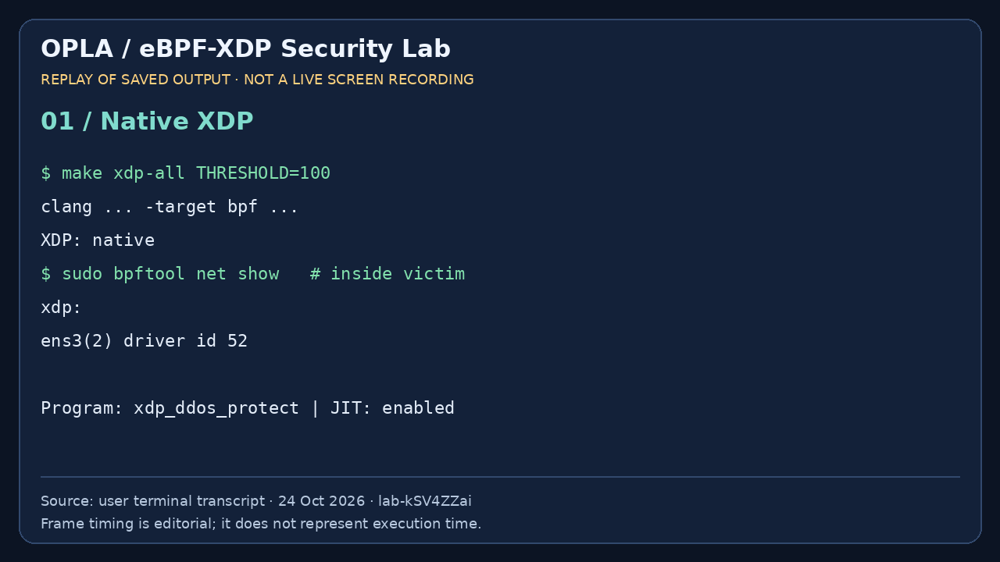
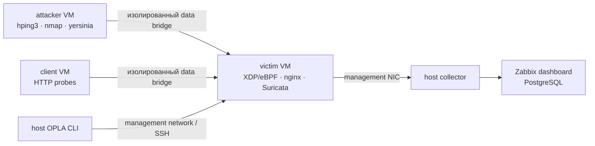

# OPLA Security Lab

[](https://gitlab.com/k3rnel_co0n/opla-security-lab/-/pipelines)
[](LICENSE)

Изолированная Linux-лаборатория для учебных экспериментов с сетевым трафиком,
eBPF/XDP, Suricata и Zabbix. Встроенный стенд состоит из трёх Debian VM:
`attacker` генерирует разрешённый тестовый трафик, `victim` применяет XDP и
Suricata, `client` независимо проверяет доступность HTTP. Zabbix собирает
метрики защиты и приложения и показывает их на dashboard.

> Запускайте лабораторию только на выделенном или явно допущенном Linux-хосте.
> Создание и удаление лабораторий меняет host-сеть и безвозвратно удаляет VM
> диски. Репозиторий не является универсальной защитой от атак и не предназначен
> для воздействия на чужие сети.

## Демонстрация



Это анимация ранее сохранённого вывода, а не live-запуск текущей версии и не
доказательство готовности Zabbix. [Записанная CLI-демонстрация](assets/demo/services/README.md)
синтетическая и безопасно воспроизводится без VM.

[Схема топологии](docs/figures/topology.svg) ·
[Схема пути пакета](docs/figures/packet-path.svg) ·
[Видео replay](assets/demo/terminal-replay.mp4) ·
[Исходные результаты](assets/demo/observed-results.json)

## Учебная работа и требования ТЗ

[Методические указания](docs/methodology.md) содержат цель, теорию, две схемы,
пошаговые команды с ожидаемыми результатами, Suricata/XDP/Zabbix, восстановление
и приложения. [ФОС](docs/fos.md) содержит 5 практических заданий, 12 вопросов
самопроверки и тест из 15 вопросов; ключ преподавателя собирается отдельно.
[Шаблон отчёта](docs/report-template.md), [версии и лицензии](docs/software.md),
[матрица соответствия ТЗ](docs/requirements-traceability.md) задают комплект
для сдачи. Основной текст печатного PDF — 12 pt, интервал 1,5.

```bash
make docs
make docs-teacher DOCS_PRIVATE_DIR=/tmp/opla-teacher
```

Сборка требует локально установленных зависимостей из tools/requirements-docs.txt;
`make docs-deps` устанавливает их отдельно с сетевым доступом. Public PDF не
включает ключ. Чистая live-апробация и точный manifest лицензий остаются отдельными
критериями приёмки; успешные offline-тесты их не заменяют.

## Быстрый старт

### Требования

Нужен отдельный Linux-хост x86_64 с systemd, доступным KVM, QEMU, libguestfs,
`cloud-localds`, `dnsmasq`, `iproute2`, nftables, Python/PyYAML, OpenSSH и Make.
Для Zabbix дополнительно нужны Docker Compose и доступ к локальному Docker
socket. Подготовка образов скачивает Debian packages и требует доступа к Debian
repositories из libguestfs appliance. Полный список и ограничения — в
[спецификации хоста](docs/test-host-spec.md).

Профиль выделяет гостям 3.5 GiB RAM и требует минимум 5 GiB доступной памяти
на хосте. Требуется место под role images, VM overlays, логи и backups; точный
объём зависит от состояния образов и опыта. Для сценариев нужна SSH-пара
пользователя. Текущая встроенная топология — локальный QEMU; для удалённой
инфраструктуры используйте [пользовательский deployment manifest](docs/deployment.md).

### Установка и запуск

Следующие команды выполняются **на выделенном допущенном хосте**, из проверенной
копии репозитория. Установка зависимостей хоста — отдельный шаг из
[руководства по установке](docs/local-system-install.md); команды ниже не
устанавливают системные пакеты автоматически.

1. Скачайте базовый Debian cloud image и соберите проверенные образы ролей:

   ```bash
   make bootstrap
   make images
   ```

   Это может занять несколько минут и загрузить несколько гигабайт. Если image
   build прервался, проверьте оставшийся `.part` перед повтором; для проверенного
   кандидата есть `opla system image-resume --role ROLE`.

2. Проверьте исходники, посчитайте локальный digest и установите их в новый
   root-owned каталог. `DIGEST` замените ровно на значение, полученное после
   собственного review. Уже существующую установку этот шаг не перезаписывает:

   ```bash
   python3 bin/opla-system-install.py --source "$PWD"
   sudo python3 bin/opla-system-install.py --source "$PWD" --install \
     --destination /opt/opla --expected-sha256 DIGEST
   python3 /opt/opla/bin/opla-cli-install.py install
   sudo install -d -o root -g root -m 0755 /var/lib/opla
   ```

   Snapshot переносит доступный `monitoring/.env` в пользовательский
   `~/.config/opla/monitoring.env` с режимом `0600` и не включает секрет в
   root-owned код. Для существующей БД пароль не генерируется заново.

3. Проверьте хост, создайте лабораторию и дождитесь cloud-init/SSH:

   ```bash
   opla lab create --confirm-host-changes
   opla lab list
   ```

   Скопируйте ID, напечатанный командой create, и выполните (вместо
   `lab-XXXXXXXX` подставьте свой ID):

   ```bash
   opla lab select lab-XXXXXXXX
   opla lab ready
   opla lab status
   ```

4. Включите гостевую защиту и интеграцию с Zabbix:

   ```bash
   opla lab activate lab-XXXXXXXX
   opla xdp stats
   opla ids status
   ```

   Активация настраивает XDP, HTTP/scan telemetry и Suricata на victim,
   поднимает Zabbix/PostgreSQL, обновляет dashboard и запускает сборщик. Откройте
   [Zabbix](http://127.0.0.1:8080), войдите в созданную учётную запись и смените
   начальный пароль, если он ещё не менялся. Для функциональной проверки
   изолированного сценария используйте
   [инструкцию по сценариям](docs/demonstrations.md).

## Какой способ развёртывания выбрать

Для полного сценария OPLA с тремя гостями, XDP/eBPF, Suricata и Zabbix выбирайте
**локальную QEMU-лабораторию на выделенном Linux-хосте**. Это единственный
встроенный шаблон топологии проекта. Не запускайте его на рабочем компьютере
или сервере с ценными сетевыми/Docker workloads без отдельного допуска.

| Вариант | Для чего подходит | Порядок и ограничения |
|---|---|---|
| Локальная QEMU-лаборатория | Полный учебный стенд `attacker`/`victim`/`client` и dashboard Zabbix | Следуйте [быстрому старту выше](#быстрый-старт) и [руководству оператора](docs/operator-guide.md). Создание меняет host network и создаёт VM-диски. |
| Подготовка QEMU-хоста через Ansible | Установка host-зависимостей на отдельной машине | Это только подготовка хоста. Затем отдельно выполняются [bootstrap, сборка образов и запуск](#установка-и-запуск); playbook не создаёт лабораторию. |
| Security node через Ansible | Отдельный Debian 13 узел с XDP, Suricata и локальной телеметрией | Это серверный профиль, а не трёх-VМ шаблон; требуется отдельный интерфейс для исследуемого трафика. Смотрите [варианты SSH/local/VPN/bastion и их ограничения](docs/deployment.md). |
| Своя удалённая инфраструктура | Узлы и адреса, задаваемые владельцем окружения | Используйте пользовательский [deployment manifest](docs/deployment.md). OPLA проверяет inventory и строит connectivity plan; это не автоматическое развёртывание произвольной распределённой топологии. |

Подробности о доверенной установке, обновлении CLI и различии checkout/`/opt`
собраны в [руководстве по локальной установке](docs/local-system-install.md).
Текущие роли, ограничения приёмки и признаки состояния описаны в
[руководстве оператора](docs/operator-guide.md) и [runtime readiness](docs/runtime-readiness.md).

## Удалить все лаборатории

Вставьте блок целиком в Bash. Он выводит найденные ID, требует ввести
`DELETE-ALL-LABS`, затем для каждого зарегистрированного корректного стенда
останавливает его collector и VM и вызывает штатный проверяющий executor.
При первой ошибке блок прекращает работу: оставшиеся лаборатории не затрагиваются.

```bash
set -euo pipefail
LAB_LIST="$(opla lab list)"
LAB_IDS="$(printf '%s\n' "$LAB_LIST" | python3 -c '
import re, sys
ids = []
for line in sys.stdin:
    fields = line.split()
    if fields and re.fullmatch(r"lab-[A-Za-z0-9]{4,32}", fields[0]):
        if len(fields) < 2 or fields[1] == "INVALID":
            raise SystemExit("BLOCKED: есть некорректная запись lab; проверьте opla lab list")
        ids.append(fields[0])
print("\n".join(ids))
')"
if [[ -z "$LAB_IDS" ]]; then
  echo 'Зарегистрированных лабораторий нет.'
  exit 0
fi
printf 'Будут безвозвратно удалены эти лаборатории и их VM-диски:\n%s\n' "$LAB_IDS"
read -r -p 'Для подтверждения введите DELETE-ALL-LABS: ' CONFIRM_ALL
[[ "$CONFIRM_ALL" == DELETE-ALL-LABS ]] || { echo 'Отменено.'; exit 1; }
while IFS= read -r LAB_ID; do
  [[ -n "$LAB_ID" ]] || continue
  command opla lab select "$LAB_ID"
  opla monitoring stop
  opla lab stop
  command opla lab delete "$LAB_ID" --confirm-lab "$LAB_ID"
done <<< "$LAB_IDS"
opla lab list
```

Удаляются только лаборатории, перечисленные в `opla lab list`, и принадлежащие
им ресурсы после ownership-проверок. Если executor отвечает `BLOCKED`, не
обходите отказ командами `rm`, `nft flush`, `docker prune` или ручным удалением
каталога. Скрипт не удаляет `images/*.qcow2`, reports, backups, общий
Zabbix/PostgreSQL volume или историю dashboard. Для сохранения базы мониторинга
это ожидаемое поведение. Чтобы удалить только один lab, используйте
`opla lab delete lab-XXXXXXXX --confirm-lab lab-XXXXXXXX`.

## Основные команды

| Задача | Команда |
|---|---|
| Список / выбор лаборатории | `opla lab list` · `opla lab select lab-XXXXXXXX` |
| Статус / диагностика | `opla lab status` · `opla system doctor` |
| Остановить, сохранив диски | `opla lab stop` |
| Запустить сохранённый стенд | `opla lab start` · `opla lab ready` |
| Защитные счётчики / IDS | `opla xdp stats` · `opla ids status` |
| Сценарии | `opla scenario check syn-scan-baseline --lab lab-XXXXXXXX` |
| Остановить общий monitoring stack | `opla monitoring down` |

`lab stop` сохраняет VM-диски; удаление требует отдельного подтверждения.
Zabbix/PostgreSQL — общие для лабораторий и не останавливаются при удалении
одного lab. Не запускайте `docker compose down --volumes`, если хотите сохранить
БД и историю метрик.

## Почтовые уведомления

Почта — отдельная опциональная интеграция поверх событий Zabbix. При первом
подключении пользователь сам задаёт от одного до двадцати адресов-получателей.
Один сохранённый Gmail app password используется только как SMTP-учётная запись
отправителя; получать письма можно на адреса любых почтовых провайдеров.
Конфигурация находится в `~/.config/opla/alerts.json`, очереди и cursors
разделены по стендам в `~/.local/state/opla-alerts/labs/<LAB_ID>/`, служба
systemd пользователя называется `opla-alerts.service`.

Проверить сохранённое состояние без вывода секретов:

```bash
systemctl --user is-active opla-alerts.service
python3 /opt/opla/monitoring/alert_delivery.py status
stat -c '%a %n' "$HOME/.config/opla/alerts.json"
```

Интеграция отправляет почту через локальный Tor SOCKS5 `127.0.0.1:9050`.
Сборщик автоматически читает выбранный `opla lab select lab-...` и обращается к
Zabbix host `opla-<полный-ID-стенда>`. При переключении выбора он переключает
Zabbix-цель и очередь этого стенда; перезапускать службу не требуется. События
и курсоры сохраняются отдельно для каждого стенда и продолжат обработку, когда
он будет выбран снова. Уже начатая SMTP-отправка может завершиться после
переключения выбора. Существующая legacy-очередь будет переиспользована только
если её старый host точно совпадает с выбранным стендом. Удаление стенда не удаляет почтовую конфигурацию,
очереди и не отключает службу. Для работы нужны Zabbix API token, Gmail app
password и запущенный локальный Tor SOCKS endpoint; секреты хранятся в
пользовательском файле с режимом `0600`.

Первичная настройка на установленной копии (только если `alerts.json` ещё нет):

```bash
python3 /opt/opla/monitoring/alert_delivery.py configure
python3 /opt/opla/monitoring/alert_delivery.py test
python3 /opt/opla/monitoring/alerts_service.py install
```

Сначала выберите существующий стенд командой `opla lab select lab-...`.
`configure` запросит Gmail sender, список адресов через запятую, Zabbix API
token и Gmail app password. Проверит, что локальный Zabbix содержит host
выбранного стенда. Дальше служба сама следует за выбором lab. Команда `test`
отправляет настоящее тестовое письмо получателям. Если `alerts.json` уже есть,
`configure` откажется перезаписывать его: сохраните файл и очередь, если хотите
переходить на новую установку, и не копируйте секреты в репозиторий. Старые
конфигурации с фиксированным `host` продолжают работать, когда lab не выбран;
при наличии выбора выбранная лаборатория имеет приоритет. Старый общий queue
файл сохраняется; если его сохранённый host совпадает с выбранным lab, OPLA
продолжит использовать эту очередь, иначе оставит её без изменений и создаст
отдельную очередь выбранного стенда.

### После создания API token в Zabbix

В Zabbix 7.0 API token создаётся в разделе **User settings → API tokens**;
в зависимости от роли управление также доступно через **Users → API tokens**.
Значение token показывается только при создании — сразу сохраните его в
менеджер секретов. Token наследует права назначенного пользователя: для OPLA
нужны доступ к host выбранной лаборатории и чтение событий/problems через API.
Смотрите [официальную документацию Zabbix по User settings и API tokens](https://www.zabbix.com/documentation/7.0/en/manual/web_interface/user_profile)
и [справочник Zabbix API](https://www.zabbix.com/documentation/7.0/en/manual/api).

Затем:

1. Выберите lab, чей host уже создан в Zabbix:

   ```bash
   opla lab select lab-XXXXXXXX
   ```

2. Если `~/.config/opla/alerts.json` **ещё не существует**, запустите первичную
   настройку. Вставьте token только в скрытый интерактивный prompt:

   ```bash
   python3 /opt/opla/monitoring/alert_delivery.py configure
   ```

   Введите Gmail sender, адреса получателей через запятую, API token и Gmail
   app password. Не вставляйте token в командную строку, issue или Git.

3. Если `alerts.json` **уже существует**, не запускайте `configure`: он намеренно
   не перезаписывает секреты. Для изменения только получателей используйте
   `recipients`, затем переустановите/перезапустите службу:

   ```bash
   python3 /opt/opla/monitoring/alert_delivery.py recipients
   python3 /opt/opla/monitoring/alerts_service.py install
   ```

   Эта команда сохраняет текущие API/SMTP secrets.

   Если нужно заменить сохранённый API token, сначала выберите правильный lab,
   затем запустите отдельное действие. Оно проверит token на API версии 7.0,
   доступ к выбранному host, problems и events и только затем сохранит его:

   ```bash
   python3 /opt/opla/monitoring/alert_delivery.py api-token
   python3 /opt/opla/monitoring/alerts_service.py install
   ```

   Token запрашивается скрыто; не вставляйте его в shell history.

4. Для настоящего тестового письма worker не должен уже держать очередь:

   ```bash
   systemctl --user stop opla-alerts.service
   python3 /opt/opla/monitoring/alert_delivery.py test
   python3 /opt/opla/monitoring/alerts_service.py install
   ```

   Успех `test` показывает принятие SMTP-сервером, но не подтверждает появление
   письма во входящих. После установки проверьте выбранную цель через
   `python3 /opt/opla/monitoring/alert_delivery.py status` и журнал через
   `journalctl --user -u opla-alerts.service -n 50 --no-pager`.

Если CLI в `/opt/opla` сообщает, что `recipients` — недопустимое действие,
там стоит старая копия проекта. Git checkout сам не обновляет root-owned
установку; используйте [процедуру обновления в новый snapshot](docs/local-system-install.md#обновление-установленного-cli).

Команда ручной проверки `alert_delivery.py test` отправляет реальное тестовое
письмо заданным получателям; запускайте её только когда это ожидаемо. Статус SMTP
`accepted` означает, что SMTP сервер принял сообщение, а не подтверждение его
появления во входящих.

Чтобы позже заменить список адресов, выполните интерактивную команду. Она
атомарно обновит только список, сохранив API token и SMTP secret:

```bash
python3 /opt/opla/monitoring/alert_delivery.py recipients
python3 /opt/opla/monitoring/alerts_service.py install
```

Введите полный новый список через запятую. Повторный `install` перезапустит
работающую пользовательскую службу, чтобы она загрузила обновлённые адреса.

В проекте есть также альтернативный путь через штатный Zabbix email media type
(`monitoring/configure-mail.py`). Не включайте оба пути одновременно, если не
нужны дублирующие письма. Удаление lab не отзывает Gmail app password или
Zabbix API token; отзывайте их отдельно, если интеграция больше не нужна.

## Как устроен проект



У каждой VM отдельные data и management интерфейсы. Тестовые инструменты
attacker предназначены только для изолированной лаборатории. XDP фильтрует
часть IPv4/TCP SYN и предоставляет scan policy; Suricata работает отдельно как
IDS/IPS. Счётчик XDP сам по себе не доказывает, что Suricata обнаружила событие
или что все метрики дошли до Zabbix.

## Технологии и первичные ресурсы

Ссылки ведут на документацию проектов и upstream-инструментов. Версии в
документации могут отличаться от закреплённых пакетных версий стенда.

| Технология | Использование в OPLA | Документация |
|---|---|---|
| [Debian Cloud](https://cloud.debian.org/images/cloud/) | Основа guest role images | [Cloud images](https://cloud.debian.org/images/cloud/) |
| [QEMU](https://www.qemu.org/docs/master/system/index.html) + [KVM](https://www.kernel.org/doc/html/latest/virt/kvm/index.html) | Три локальные VM, QMP, QCOW2 и ускорение виртуализации | [QEMU System Emulation](https://www.qemu.org/docs/master/system/index.html) · [Linux KVM](https://www.kernel.org/doc/html/latest/virt/kvm/index.html) |
| [Linux eBPF/XDP](https://docs.ebpf.io/linux/program-type/BPF_PROG_TYPE_XDP/) | Ранняя обработка пакетов на victim, XDP maps и счётчики | [XDP program type](https://docs.ebpf.io/linux/program-type/BPF_PROG_TYPE_XDP/) · [kernel BPF docs](https://docs.kernel.org/bpf/) |
| [Suricata](https://docs.suricata.io/en/suricata-7.0.10/) | IDS/IPS, правила и EVE JSON события | [Suricata 7.0 guide](https://docs.suricata.io/en/suricata-7.0.10/) |
| [Zabbix 7.0](https://www.zabbix.com/documentation/7.0/en/manual) | Items, triggers, graphs, dashboard и уведомления | [Zabbix 7.0 manual](https://www.zabbix.com/documentation/7.0/en/manual) · [API](https://www.zabbix.com/documentation/7.0/en/manual/api) |
| [Docker Compose](https://docs.docker.com/compose/) + [PostgreSQL](https://www.postgresql.org/docs/) | Общие контейнеры Zabbix и постоянное хранилище БД | [Compose docs](https://docs.docker.com/compose/) · [PostgreSQL docs](https://www.postgresql.org/docs/) |
| [nftables](https://wiki.nftables.org/wiki-nftables/index.php/Main_Page) | Изолированные bridge/TAP сети и host firewall policy | [nftables HOWTO](https://wiki.nftables.org/wiki-nftables/index.php/Main_Page) |
| [systemd](https://www.freedesktop.org/software/systemd/man/latest/) + [OpenSSH](https://www.openssh.com/manual.html) | QEMU/user services и управление гостями по management SSH | [systemd manuals](https://www.freedesktop.org/software/systemd/man/latest/) · [OpenSSH manuals](https://www.openssh.com/manual.html) |
| [Nmap](https://nmap.org/book/man.html), [Yersinia](https://github.com/tomac/yersinia), [hping3](https://www.kali.org/tools/hping3/), [arp-scan](https://github.com/royhills/arp-scan), [tcpdump](https://www.tcpdump.org/) | Инструменты генерации и наблюдения трафика внутри attacker/test network | Upstream manuals и репозитории проектов |
| [Tor Project](https://support.torproject.org/) + [curl](https://curl.se/docs/manpage.html) | SMTP уведомления через локальный SOCKS5 proxy | [Tor support](https://support.torproject.org/) · [curl manual](https://curl.se/docs/manpage.html) |
| [GitLab CI/CD](https://docs.gitlab.com/ci/) + [Python](https://docs.python.org/3/) | Проверки, сборка и orchestration tooling | [GitLab CI docs](https://docs.gitlab.com/ci/) · [Python docs](https://docs.python.org/3/) |

## Проверки и границы результата

Статические проверки и offline-тесты не запускают полноценную цепочку KVM →
XDP verifier → Suricata → сценарий → Zabbix. Не называйте стенд готовым только
потому, что QEMU запущен или health endpoint отвечает. Перед live-экспериментом
проверьте XDP/IDS, client HTTP probe, свежесть данных Zabbix и evidence сценария.

Подробные документы:

- [Установка и обновление](docs/local-system-install.md)
- [Руководство оператора](docs/operator-guide.md)
- [Справочник команд](docs/user-guide/commands.md)
- [Топология и требования хоста](docs/test-host-spec.md)
- [Zabbix и метрики](docs/zabbix-guide.md) · [каталог метрик](docs/metrics-catalog.md)
- [Сценарии и демонстрации](docs/demonstrations.md)
- [Удаление и жизненный цикл данных](docs/data-lifecycle.md)
- [Безопасность и модель доверия](docs/security-model.md)
- [Приёмка и runtime readiness](docs/acceptance.md) · [статус runtime](docs/runtime-readiness.md)
- [Вся документация](docs/README.md)

## Участие и лицензия

Перед изменениями ознакомьтесь с [CONTRIBUTING](CONTRIBUTING.md) и
[SECURITY](SECURITY.md). Запускайте `make check` для переносимых проверок;
они не заменяют live-приёмку на отдельном тестовом хосте. См. также
[GitLab CI](https://gitlab.com/k3rnel_co0n/opla-security-lab/-/pipelines),
[лицензию](LICENSE) и [лицензионные пояснения](LICENSING.md).
