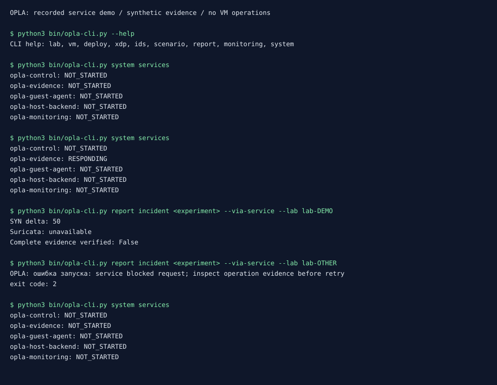
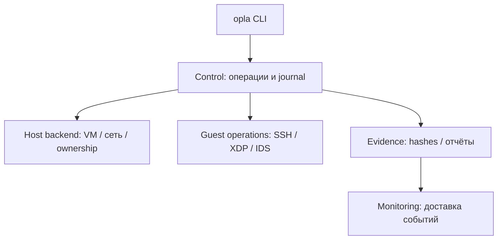

# OPLA Security Lab

Учебная Linux-лаборатория для экспериментов с **eBPF/XDP, Suricata и HTTP-защитой**.
Три VM разделяют роли: attacker создаёт трафик, victim содержит защищаемый
nginx и средства защиты, client независимо проверяет доступность.
Zabbix/PostgreSQL — дополнительный общий стек наблюдения.

Проект разрабатывается в рамках учебной работы по информационной безопасности.
Результаты отдельных опытов не означают промышленную готовность или поддержку
любой ОС, архитектуры процессора и сетевого драйвера.

[Руководство оператора](docs/operator-guide.md) ·
[Установка и обновление](docs/local-system-install.md) ·
[Команды](docs/user-guide/commands.md) ·
[Демонстрации](docs/demonstrations.md) ·
[Архитектура](docs/service-management-architecture.md) ·
[Вся документация](docs/README.md)

## Что подтверждено

| Область | Подтверждение и граница |
|---|---|
| VM lifecycle | В сессии 28.10.2026 проверены create, stop/start и SSH/cloud-init трёх VM; это не полный XDP/IDS/scenario acceptance |
| Сервисный runtime | Реальные Unix worker-процессы, peer UID, identity/deadline checks и evidence API проверены процессными тестами |
| Локальные проверки | На базе `b190d09`: 647 тестов без пропусков; [отчёт процессной приёмки](docs/evidence/service-process-acceptance-20261028.json) привязан к hashes исходников |
| Исторические SYN/HTTP-опыты | [Сохранённые результаты](assets/demo/observed-results.json); не повторный запуск текущей версии |
| Полная миграция к сервисам | В работе: root/guest business API ещё не заменяет все прямые launcher-вызовы |
| Другие ОС/ISA и clean deployment | Требуют отдельной [платформенной приёмки](docs/platform-compatibility.md) |

`make check` не выполняет clang BPF backend, kernel verifier, live KVM или
Zabbix API. Команда health сервиса не доказывает готовность стенда.

## Демонстрации



[Пошаговый вывод](assets/demo/services/README.md) ·
[Полный stdout/stderr и fixture](assets/demo/services/transcript.json) ·
[Как воспроизвести](docs/demonstrations.md)

Это реальный запуск CLI и worker-процесса с **синтетическими evidence**:
NOT_STARTED → RESPONDING → отчёт → отказ для чужого lab_id → остановка worker.
SVG визуализирует сохранённый вывод, а не изображает скриншот live-стенда.

Ранее сохранённая демонстрация SYN/HTTP:
[GIF](assets/demo/terminal-replay.gif) · [MP4](assets/demo/terminal-replay.mp4).
Это replay исторического вывода, не новый запуск и не измерение производительности.

## Быстрый старт

### Проверка исходников

Из корня checkout:

```bash
python3 -m compileall -q bin tests
make check
```

Для процессных тестов нужны локальные Unix sockets. Остальные зависимости —
в [спецификации хоста](docs/test-host-spec.md).
Скачивание пакетов и образов не входит в эти проверки.

### Установка

Нужны Linux amd64, systemd, KVM, QEMU, cloud-localds, libguestfs, dnsmasq,
iproute2, nftables, Python/PyYAML, OpenSSH и make. Для мониторинга отдельно
нужен Docker/Compose. VM получают 1024/2048/512 MiB; create дополнительно
проверяет резерв 1536 MiB доступной RAM. Диски, backups и обновления требуют места.

Все три role images обязательны: attacker/client/victim; отсутствующий image
не заменяется другим. Bootstrap скачивает base image, а image-команда готовит
роль через libguestfs. Existing image/partial не перезаписывается. Не запускайте
подготовку поверх backing files сохранённых VM.

`make install` устанавливает только пользовательский CLI wrapper.
Для privileged запуска нужен root-owned snapshot: следуйте
[полной инструкции установки](docs/local-system-install.md).
Она объясняет digest, `/opt/opla`, каталог `/var/lib/opla` и SSH public key.
Private key остаётся в домашнем каталоге пользователя.

**Git checkout и установленная копия независимы:** git pull не обновляет
`/opt/opla`. Новый CLI запускайте после согласованного обновления его файлов.

### Работа через opla

Команды выполняются обычным пользователем из любой папки.
Создание нового стенда изменяет host network/firewall:

```bash
opla lab create --confirm-host-changes
opla lab list
```

Выберите ID из вывода; `lab-XXXXXXXX` — placeholder:

```bash
opla lab select lab-XXXXXXXX
opla lab ready
opla lab status
opla vm ssh --vm victim
```

Для сохранённого стенда используйте `opla lab start`, затем `opla lab ready`.
Ready ждёт SSH/cloud-init, но не включает и не проверяет XDP/IDS автоматически.

```bash
opla lab stop
```

Stop штатно выключает VM и убирает принадлежащую стенду сеть, сохраняя диски.
Общий monitoring имеет отдельный lifecycle. `make down` заблокирован.
Delete — отдельная необратимая verified operation с точным ID и подтверждением.

**Без sudo перед CLI — да; полностью без root-привилегий — нет.**
Host operations сами запрашивают sudo в терминале. Автоматическая работа без
пароля и полностью rootless QEMU backend не реализованы. [Права и ресурсы](docs/resource-and-user-operation.md).

## Архитектура



Это целевые бизнес-границы. Реализованы process transport и отдельный evidence
API; остальные команды пока используют существующие launchers.
Data NIC с XDP и management NIC с SSH разделены.
[Краткая архитектура](docs/architecture.md) ·
[API, права и gates миграции](docs/service-management-architecture.md).

После обновления установки: `opla system services`.
Из checkout: `python3 bin/opla-cli.py system services`.
NOT_STARTED означает отсутствие socket сервиса, а не остановленную VM.

## Защита eBPF/XDP

XDP работает на data NIC внутри victim: initial IPv4 TCP SYN rate limiting,
bounds checks, до двух VLAN headers, fragment policy и distinct-port scan.
Scan policy observe/block/off не заменяет IDS/IPS. Native/generic attach mode
нужно записывать в evidence; loaded=1 сам по себе не доказывает нужную программу.

[Руководство XDP](docs/user-guide/xdp.md) · [каталог метрик](docs/metrics-catalog.md).

## Метрики и панели Zabbix

Zabbix получает XDP/HTTP/IDS/scan telemetry, производные скорости и события.
Числа и wire keys определяются исходным каталогом и проверяются тестами.
Общий Compose stack не принадлежит одному стенду; его остановка влияет на всех
потребителей. [Zabbix](docs/zabbix-guide.md) · [эксплуатация](docs/operations.md).

## Проверки и эксперименты

```bash
make check
python3 bin/opla-service-acceptance.py --verify docs/evidence/service-process-acceptance-20261028.json
```

Вторая команда проверяет свежесть сохранённого отчёта; при изменении исходников
нужно провести приёмку заново с новым output. Это hashes, не подпись издателя.
[Демонстрации и повторный запуск](docs/demonstrations.md) ·
[матрица приёмки](docs/acceptance.md).

## CI/CD

[GitLab](.gitlab-ci.yml) · [GitHub Actions](.github/workflows/check.yml).
Jobs проверяют переносимую логику, конфигурации, сборку BPF и артефакты;
удалённый pipeline конкретного commit нужно проверять отдельно.
Исторический pipeline `2985024140` относится к `96ef03bb`, а не к текущему HEAD.

Release bundle/stage/promote/DEB остаются review/inert artifacts.
Локальная root-owned установка — отдельное явное доверие выбранным исходникам.
[Подготовка релиза](docs/release.md) · [Ansible deployment](docs/deployment.md).

## Ограничения и модель доверия

Нет универсальной защиты L2–L7, TLS inspection, автоматической поддержки другой
ISA или доказанного ускорения относительно netfilter. Missing telemetry нельзя
подменять нулём; client coverage и XDP/IDS fingerprints проверяются отдельно.
Не удаляйте backing images сохранённых VM, не очищайте firewall глобально и не
используйте Docker prune для очистки одного стенда.

[Модель доверия](docs/security-model.md) · [backup/restore](docs/backup-restore.md) ·
[данные и удаление](docs/data-lifecycle.md) · [платформы](docs/platform-compatibility.md).

Исходники: `bin/`, `xdp/`, `security/`, `monitoring/`, `cloud-init/`,
`ansible/`, `deploy/`, `tests/`. Публичная документация — `docs/`;
секреты, qcow2, runtime и приватные backups в Git не публикуются.

[Участие](CONTRIBUTING.md) · [Безопасность](SECURITY.md) ·
[Лицензия](LICENSE) · [Лицензионные пояснения](LICENSING.md).
