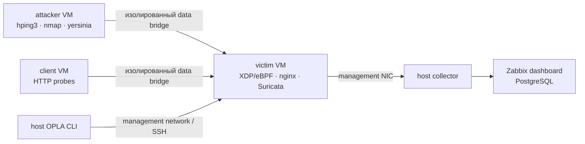

# OPLA Security Lab

[](https://gitlab.com/k3rnel_co0n/opla-security-lab/-/pipelines)
[](LICENSE)

Изолированная Linux-лаборатория для учебных экспериментов с сетевым трафиком,
eBPF/XDP, Suricata и Zabbix. Встроенный стенд состоит из трёх Debian VM:
`attacker` генерирует разрешённый тестовый трафик, `victim` применяет XDP и
Suricata, `client` независимо проверяет доступность HTTP. Zabbix собирает
метрики защиты и приложения и показывает их на dashboard.

> Запускайте лабораторию только на выделенном или явно допущенном Linux-хосте.
> Создание и удаление лабораторий меняет host-сеть и безвозвратно удаляет VM
> диски. Репозиторий не является универсальной защитой от атак и не предназначен
> для воздействия на чужие сети.

## Демонстрация


Это анимация ранее сохранённого вывода, а не live-запуск текущей версии и не
доказательство готовности Zabbix. [Записанная CLI-демонстрация](assets/demo/services/README.md)
синтетическая и безопасно воспроизводится без VM.

[Схема топологии](docs/figures/topology.svg) ·
[Схема пути пакета](docs/figures/packet-path.svg) ·
[Видео replay](assets/demo/terminal-replay.mp4) ·
[Исходные результаты](assets/demo/observed-results.json)

## Быстрый старт

### Требования

Нужен отдельный Linux-хост x86_64 с systemd, доступным KVM, QEMU, libguestfs,
`cloud-localds`, `dnsmasq`, `iproute2`, nftables, Python/PyYAML, OpenSSH и Make.
Для Zabbix дополнительно нужны Docker Compose и доступ к локальному Docker
socket. Подготовка образов скачивает Debian packages и требует доступа к Debian
repositories из libguestfs appliance. Полный список и ограничения — в
[спецификации хоста](docs/test-host-spec.md).

Профиль выделяет гостям 3.5 GiB RAM и требует минимум 5 GiB доступной памяти
на хосте. Требуется место под role images, VM overlays, логи и backups; точный
объём зависит от состояния образов и опыта. Для сценариев нужна SSH-пара
пользователя. Текущая встроенная топология — локальный QEMU; для удалённой
инфраструктуры используйте [пользовательский deployment manifest](docs/deployment.md).

### Установка и запуск

Следующие команды выполняются **на выделенном допущенном хосте**, из проверенной
копии репозитория. Установка зависимостей хоста — отдельный шаг из
[руководства по установке](docs/local-system-install.md); команды ниже не
устанавливают системные пакеты автоматически.

1. Скачайте базовый Debian cloud image и соберите проверенные образы ролей:

   ```bash
   make bootstrap
   make images
   ```

   Это может занять несколько минут и загрузить несколько гигабайт. Если image
   build прервался, проверьте оставшийся `.part` перед повтором; для проверенного
   кандидата есть `opla system image-resume --role ROLE`.

2. Проверьте исходники, посчитайте локальный digest и установите их в новый
   root-owned каталог. `DIGEST` замените ровно на значение, полученное после
   собственного review. Уже существующую установку этот шаг не перезаписывает:

   ```bash
   python3 bin/opla-system-install.py --source "$PWD"
   sudo python3 bin/opla-system-install.py --source "$PWD" --install \
     --destination /opt/opla --expected-sha256 DIGEST
   python3 /opt/opla/bin/opla-cli-install.py install
   sudo install -d -o root -g root -m 0755 /var/lib/opla
   ```

   Snapshot переносит доступный `monitoring/.env` в пользовательский
   `~/.config/opla/monitoring.env` с режимом `0600` и не включает секрет в
   root-owned код. Для существующей БД пароль не генерируется заново.

3. Проверьте хост, создайте лабораторию и дождитесь cloud-init/SSH:

   ```bash
   opla lab create --confirm-host-changes
   opla lab list
   ```

   Скопируйте ID, напечатанный командой create, и выполните (вместо
   `lab-XXXXXXXX` подставьте свой ID):

   ```bash
   opla lab select lab-XXXXXXXX
   opla lab ready
   opla lab status
   ```

4. Включите гостевую защиту и интеграцию с Zabbix:

   ```bash
   opla lab activate lab-XXXXXXXX
   opla xdp stats
   opla ids status
   ```

   Активация настраивает XDP, HTTP/scan telemetry и Suricata на victim,
   поднимает Zabbix/PostgreSQL, обновляет dashboard и запускает сборщик. Откройте
   [Zabbix](http://127.0.0.1:8080), войдите в созданную учётную запись и смените
   начальный пароль, если он ещё не менялся. Для функциональной проверки
   изолированного сценария используйте
   [инструкцию по сценариям](docs/demonstrations.md).

## Удалить все лаборатории

Вставьте блок целиком в Bash. Он выводит найденные ID, требует ввести
`DELETE-ALL-LABS`, затем для каждого зарегистрированного корректного стенда
останавливает его collector и VM и вызывает штатный проверяющий executor.
При первой ошибке блок прекращает работу: оставшиеся лаборатории не затрагиваются.

```bash
set -euo pipefail
LAB_LIST="$(opla lab list)"
LAB_IDS="$(printf '%s\n' "$LAB_LIST" | python3 -c '
import re, sys
ids = []
for line in sys.stdin:
    fields = line.split()
    if fields and re.fullmatch(r"lab-[A-Za-z0-9]{4,32}", fields[0]):
        if len(fields) < 2 or fields[1] == "INVALID":
            raise SystemExit("BLOCKED: есть некорректная запись lab; проверьте opla lab list")
        ids.append(fields[0])
print("\n".join(ids))
')"
if [[ -z "$LAB_IDS" ]]; then
  echo 'Зарегистрированных лабораторий нет.'
  exit 0
fi
printf 'Будут безвозвратно удалены эти лаборатории и их VM-диски:\n%s\n' "$LAB_IDS"
read -r -p 'Для подтверждения введите DELETE-ALL-LABS: ' CONFIRM_ALL
[[ "$CONFIRM_ALL" == DELETE-ALL-LABS ]] || { echo 'Отменено.'; exit 1; }
while IFS= read -r LAB_ID; do
  [[ -n "$LAB_ID" ]] || continue
  opla lab select "$LAB_ID"
  opla monitoring stop
  opla lab stop
  opla lab delete "$LAB_ID" --confirm-lab "$LAB_ID"
done <<< "$LAB_IDS"
opla lab list
```

Удаляются только лаборатории, перечисленные в `opla lab list`, и принадлежащие
им ресурсы после ownership-проверок. Если executor отвечает `BLOCKED`, не
обходите отказ командами `rm`, `nft flush`, `docker prune` или ручным удалением
каталога. Скрипт не удаляет `images/*.qcow2`, reports, backups, общий
Zabbix/PostgreSQL volume или историю dashboard. Для сохранения базы мониторинга
это ожидаемое поведение. Чтобы удалить только один lab, используйте
`opla lab delete lab-XXXXXXXX --confirm-lab lab-XXXXXXXX`.

## Основные команды

| Задача | Команда |
|---|---|
| Список / выбор лаборатории | `opla lab list` · `opla lab select lab-XXXXXXXX` |
| Статус / диагностика | `opla lab status` · `opla system doctor` |
| Остановить, сохранив диски | `opla lab stop` |
| Запустить сохранённый стенд | `opla lab start` · `opla lab ready` |
| Защитные счётчики / IDS | `opla xdp stats` · `opla ids status` |
| Сценарии | `opla scenario check syn-scan-baseline --lab lab-XXXXXXXX` |
| Остановить общий monitoring stack | `opla monitoring down` |

`lab stop` сохраняет VM-диски; удаление требует отдельного подтверждения.
Zabbix/PostgreSQL — общие для лабораторий и не останавливаются при удалении
одного lab. Не запускайте `docker compose down --volumes`, если хотите сохранить
БД и историю метрик.

## Как устроен проект



У каждой VM отдельные data и management интерфейсы. Тестовые инструменты
attacker предназначены только для изолированной лаборатории. XDP фильтрует
часть IPv4/TCP SYN и предоставляет scan policy; Suricata работает отдельно как
IDS/IPS. Счётчик XDP сам по себе не доказывает, что Suricata обнаружила событие
или что все метрики дошли до Zabbix.

## Проверки и границы результата

Статические проверки и offline-тесты не запускают полноценную цепочку KVM →
XDP verifier → Suricata → сценарий → Zabbix. Не называйте стенд готовым только
потому, что QEMU запущен или health endpoint отвечает. Перед live-экспериментом
проверьте XDP/IDS, client HTTP probe, свежесть данных Zabbix и evidence сценария.

Подробные документы:

- [Установка и обновление](docs/local-system-install.md)
- [Руководство оператора](docs/operator-guide.md)
- [Справочник команд](docs/user-guide/commands.md)
- [Топология и требования хоста](docs/test-host-spec.md)
- [Zabbix и метрики](docs/zabbix-guide.md) · [каталог метрик](docs/metrics-catalog.md)
- [Сценарии и демонстрации](docs/demonstrations.md)
- [Удаление и жизненный цикл данных](docs/data-lifecycle.md)
- [Безопасность и модель доверия](docs/security-model.md)
- [Приёмка и runtime readiness](docs/acceptance.md) · [статус runtime](docs/runtime-readiness.md)
- [Вся документация](docs/README.md)

## Участие и лицензия

Перед изменениями ознакомьтесь с [CONTRIBUTING](CONTRIBUTING.md) и
[SECURITY](SECURITY.md). Запускайте `make check` для переносимых проверок;
они не заменяют live-приёмку на отдельном тестовом хосте. См. также
[GitLab CI](https://gitlab.com/k3rnel_co0n/opla-security-lab/-/pipelines),
[лицензию](LICENSE) и [лицензионные пояснения](LICENSING.md).
