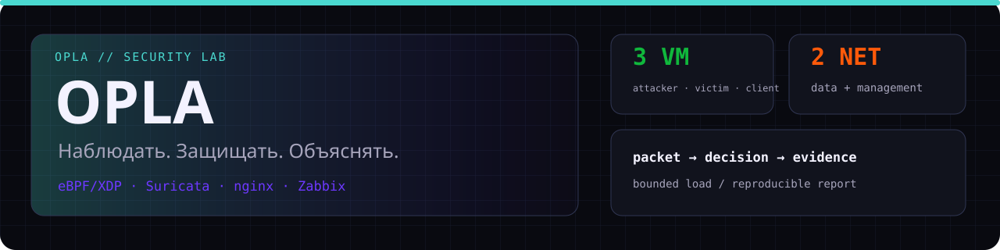
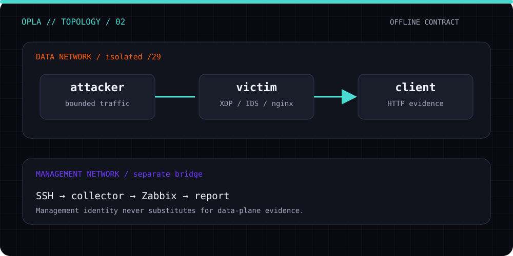
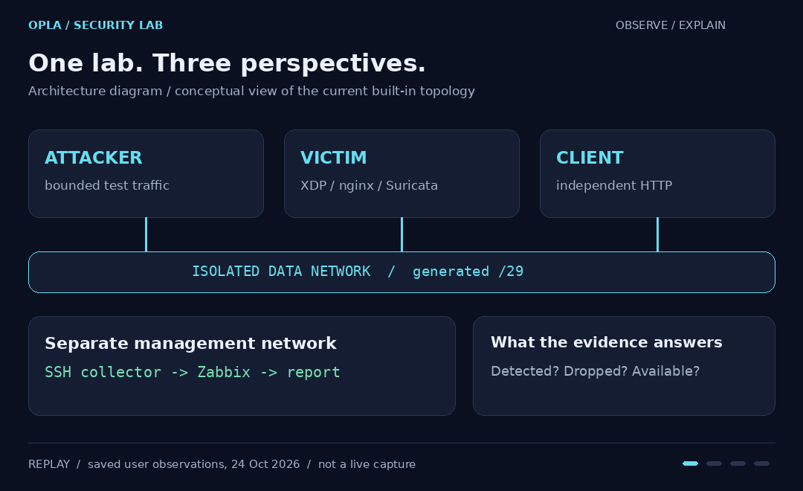
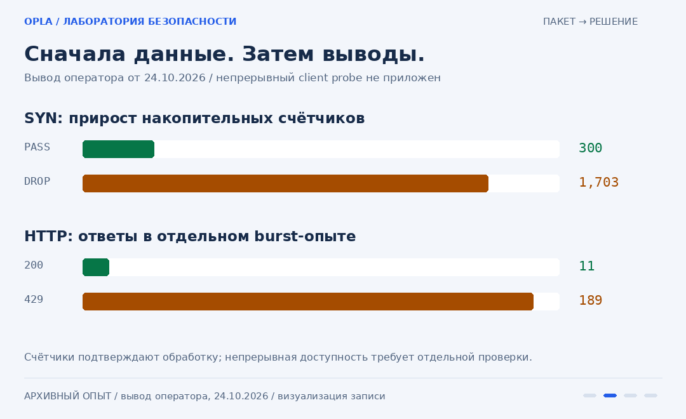

# OPLA - лаборатория безопасности Linux

### От сетевой нагрузки - к обнаружению, защите и проверяемому результату

Учебная лаборатория по дисциплине **«Обнаружение, предупреждение и ликвидация
последствий компьютерных атак»**. OPLA объединяет три Linux-ВМ, eBPF/XDP,
Suricata, nginx и Zabbix в воспроизводимый сценарий исследования сетевых атак.

Студент создаёт ограниченную нагрузку, наблюдает работу защиты, проверяет
доступность HTTP с независимого клиента и составляет отчёт на основе
счётчиков, событий и измерений. Исходники, конфигурации и методические
материалы находятся в одном репозитории.

[Начать работу](#быстрый-старт) · [Методичка](docs/methodology.md) ·
[Документация](docs/README.md) · [Статус проверки](#проверки-и-статус) ·
[Что осталось до сдачи](docs/completion-checklist.md) ·
[Преподавателю](docs/teacher-guide.md)

<div align="center">

[](https://gitlab.com/k3rnel_co0n/opla-security-lab/-/pipelines)
[](https://github.com/zackshal/opla-security-lab/actions/workflows/check.yml)
[](LICENSING.md)

[](xdp/README.md)
[](bin/)
[](bin/)
[](docs/architecture.md)
[](docs/security-model.md)
[](docs/methodology.md)
[](monitoring/README.md)
[](docs/user-guide/commands.md)
[](docs/zabbix-guide.md)
[](ansible/README.md)

</div>

Технологические бейджи обозначают состав проекта. Фактические версии
фиксируются в [протоколе среды](docs/versions.md); бейджи CI относятся к
соответствующим репозиториям и не доказывают синхронность GitHub и GitLab.

> **Проверка, 31.10.2026: 986 тестов, 970 прошли, 16 пропущены.**
> Пропуски связаны с ограничениями среды проверки (AF_UNIX, запуск от UID 0);
> причины перечислены в [аудите](docs/verification-2026-10-31.md). Полный запуск
> с нуля, kernel verifier и живучесть под реальной нагрузкой требуют отдельной
> приёмки. Детали относятся к исторической проверке и не заменяют live-приёмку.

<details>
<summary><strong>Навигация по проекту</strong></summary>

- [Что изучается](#что-изучается)
- [Как устроен опыт](#как-устроен-опыт)
- [Демонстрация](#демонстрация)
- [Быстрый старт](#быстрый-старт)
- [Ежедневные команды](#ежедневные-команды)
- [Учебный комплект](#учебный-комплект)
- [Проверки и статус](#проверки-и-статус)
- [Способы развёртывания](#способы-развёртывания)
- [Почтовые уведомления](#почтовые-уведомления)
- [Частые вопросы](#частые-вопросы)
- [Технологии и первичные источники](#технологии-и-первичные-источники)
- [Помощь и участие](#помощь-и-участие)

</details>

## Что изучается

| Направление | Практический результат |
|---|---|
| eBPF/XDP | Ограничение новых IPv4 TCP SYN, политика сканирования, анализ pass/drop |
| Suricata IDS/IPS | Правила обнаружения, события EVE, проверка выбранного режима защиты |
| nginx | Ограничение HTTP-запросов и сравнение ответов 200/429 |
| Независимый клиент | Доступность и задержка HTTP до, во время и после нагрузки |
| Zabbix | Сбор метрик, события и сопоставление наблюдений |
| Эксплуатация | Создание, остановка, восстановление и контролируемое удаление стенда |

Это учебный стенд с ограниченной моделью угроз. Он не заявляет защиту от
произвольного DDoS или готовность к эксплуатации в production.

## Как устроен опыт

1. **Создать нагрузку.** Attacker отправляет конечный поток в изолированную data network.
2. **Наблюдать решение.** XDP предоставляет counters, Suricata - EVE alerts, nginx - HTTP-ответы.
3. **Проверить результат.** Client измеряет доступность, Zabbix показывает метрики, отчёт связывает evidence.

| Роль | Назначение |
|---|---|
| **attacker** | Генерация конечного тестового трафика внутри лаборатории |
| **victim** | HTTP-сервис, XDP и Suricata |
| **client** | Независимая проверка HTTP |

Управление SSH отделено от защищаемой сети данных. Адреса выделяет allocator;
значения на схеме иллюстративны.



XDP ограничивает IPv4 TCP SYN и поддерживает scan policy. Suricata обнаруживает
события; блокировка требует отдельно проверенного IPS-режима. nginx ограничивает
HTTP-запросы. Текущий каталог Zabbix содержит **49 items, 23 triggers и 5 страниц**.
[Каталог метрик](docs/metrics-catalog.md) · [Путь пакета](docs/figures/packet-path.svg) ·
[Модель доверия](docs/security-model.md).

## Демонстрация



*Схема показывает текущую архитектуру. Числовые сцены - визуализация сохранённого
вывода оператора от 24.10.2026; темп анимации не отражает время исполнения.*
[Статичный кадр](assets/demo/overview-poster.png) · [Данные и происхождение](assets/demo/README.md) ·
[Текстовый результат](assets/demo/results.txt).

### Что показывает опыт



Карточка построена из [пользовательского transcript от 24.10.2026](assets/demo/observed-results.json).
В SYN-опыте counters выросли на **2003 SYN**, **300 pass**, **1703 drop**;
отдельный HTTP burst дал **11 ответов 200** и **189 ответов 429**.
Фоновые SYN могут влиять на counters. Эти числа не являются измерением pps,
гарантией предотвращения атаки или доказательством непрерывной доступности.

Suricata evidence и полный dashboard в этой исторической записи не показаны.
Сравнивайте данные только внутри одного опыта: результат SYN и HTTP burst
не объединяется в одну временную серию.
[Текстовая версия результатов](assets/demo/results.txt) ·
[Offline CLI/evidence-worker demo](assets/demo/services/README.md) ·
[Все демонстрации](docs/demonstrations.md).

## Быстрый старт

Целевой профиль встроенного стенда - **Debian 12/13, x86_64, QEMU/KVM**.
Нужны systemd, QEMU/libguestfs, cloud-init tooling, nftables, Python/PyYAML,
Make, OpenSSH, Docker Engine и Compose. Поддержка других ОС и архитектур
не подтверждена; подробности в [матрице платформ](docs/platform-compatibility.md). Create проверяет минимум
**5 GiB MemAvailable**. Для полного опыта ориентир - 12 GiB RAM и 30 GiB
свободного диска; это запас для планирования, а не измеренный минимум. [Полные требования](docs/test-host-spec.md) и
[подготовка host-зависимостей](docs/deployment.md#1-подготовка-локального-qemu-хоста).

### Установка и запуск

Команды выполняются **на выделенном или явно допущенном тестовом хосте**.
Create меняет host networking; delete безвозвратно удаляет выбранные VM-диски.
Трафик разрешён только в data network своей лаборатории.

Сначала получите исходники и перейдите в каталог проекта:

```bash
git clone https://gitlab.com/k3rnel_co0n/opla-security-lab.git
cd opla-security-lab
```

Сначала подготовьте зависимости по [инструкции хоста](docs/deployment.md#1-подготовка-локального-qemu-хоста).
`make bootstrap` скачивает базовый образ; эта команда **не устанавливает
зависимости хоста**. Проверьте исходники обычным пользователем:

```bash
python3 -m compileall -q bin tests
make check
python3 tools/check-documentation.py
```

Для этих проверок нужны Python/PyYAML, Bash, Make и C-компилятор. Причины
`skipped` сохраняются в протоколе. После проверки переходите к развёртыванию.

**1. Подготовьте образы трёх ролей.**

```bash
make bootstrap
make images
```

Образ victim содержит Suricata, PyYAML, nginx и BPF toolchain; attacker -
hping3, nmap, arp-scan, yersinia и tcpdump. Готовые проверенные образы
переиспользуются. Для прерванной сборки - [восстановление images](docs/user-guide/commands.md).

**2. Установите проверенный snapshot и CLI.**

```bash
python3 bin/opla-system-install.py --source "$PWD"
sudo python3 bin/opla-system-install.py --source "$PWD" --install \
  --destination /opt/opla --expected-sha256 DIGEST
python3 /opt/opla/bin/opla-cli-install.py install
sudo install -d -o root -g root -m 0755 /var/lib/opla
```

Замените `DIGEST` напечатанным SHA-256 после просмотра исходников. Установка копирует код
и образы в **новый** root-owned каталог. Для обновления существующей версии
выберите другой путь и используйте его в дальнейших командах.
[Установка и обновление](docs/local-system-install.md). Checkout и `/opt` независимы.

**3. Создайте лабораторию и выберите напечатанный ID.**

```bash
opla lab create --confirm-host-changes
opla lab list
opla lab select lab-XXXXXXXX
opla lab ready
```

`lab-XXXXXXXX` в примерах заменяется реальным ID. Ожидается `cloud-init done`
для всех трёх VM. Если `LAB_DIR` задан в окружении, он имеет приоритет над
сохранённым выбором.

**4. Активируйте защиту и мониторинг.**

```bash
opla lab activate lab-XXXXXXXX
opla xdp stats
opla ids status
```

Активация настраивает гостевые модули, Zabbix/PostgreSQL, dashboard и collector.
Настройка запросит учётные данные Zabbix. Откройте [локальный Zabbix](http://127.0.0.1:8080),
смените начальный пароль и проверьте свежесть Latest data выбранного host.
[Руководство по Zabbix](docs/zabbix-guide.md).

**5. Выполните конечный сценарий.**

```bash
opla scenario check syn-scan-baseline --lab lab-XXXXXXXX
opla scenario run syn-scan-baseline --lab lab-XXXXXXXX --confirm lab-XXXXXXXX
```

Сохраните каталог результатов, указанный в выводе. Для вывода о доступности на всём
интервале нужна [непрерывная проверка с client](docs/task-client-coverage.md).
[Пошаговый учебный опыт](docs/methodology.md).

## Ежедневные команды

| Действие | Команда |
|---|---|
| Выбрать лабораторию | `opla lab list` → `opla lab select lab-XXXXXXXX` |
| Проверить VM / guest readiness | `opla lab status` · `opla lab ready` |
| Проверить защиту | `opla xdp stats` · `opla ids status` |
| Проверить Suricata marker | `opla ids test` |
| Остановить сбор метрик | `opla monitoring stop` |
| Остановить VM, сохранив диски | `opla lab stop` |
| Продолжить работу | `opla lab start` → `opla lab ready` |

### Завершение работы и удаление

Обычная остановка через `opla lab stop` сохраняет диски. Следующий блок
**безвозвратно удаляет выбранный стенд**; выполняйте его после сохранения результатов:

```bash
opla monitoring stop
opla lab stop
opla lab delete lab-XXXXXXXX --confirm-lab lab-XXXXXXXX
```

Для массового удаления используйте [готовый Bash-блок с подтверждением](docs/data-lifecycle.md#9-удалить-все-зарегистрированные-лаборатории).
Он останавливается при первой ошибке ownership-проверок. Shared Zabbix, история
БД и role images сохраняются. [Backup и восстановление](docs/backup-restore.md).

## Учебный комплект

| Материал | Содержание |
|---|---|
| [Методические указания](docs/methodology.md) | Теория, две схемы, установка, опыт и восстановление |
| [ФОС](docs/fos.md) | 5 практических заданий, 12 вопросов самопроверки, тест из 15 вопросов |
| [Шаблон отчёта](docs/report-template.md) | Результаты, fingerprints, client coverage и выводы |
| [Соответствие ТЗ](docs/requirements-traceability.md) | Требования исходного PDF и условия итоговой приёмки |
| [Средства и лицензии](docs/software.md) | Версии, назначение, установка и незакрытые лицензионные проверки |

Сборка трёх публичных PDF - методички, инженерного отчёта и портфолио:

```bash
make docs-deps
make docs
```

`make docs-deps` создаёт локальное окружение и скачивает закреплённые Python-зависимости;
нужны доступ к сети и шрифты Liberation/DejaVu. Результат - каталог
`release-artifacts/public/`. Если зависимости уже установлены, достаточно `make docs`.

Ключ преподавателя хранится отдельно и не входит в публичный clone. При наличии
локального `docs/teacher-key.md` он собирается через `make docs-teacher` в приватный
каталог. [Правила публикации](docs/release.md) · [Все документы](docs/README.md).

## Проверки и статус

Результаты относятся к проверке архива от **31.10.2026**, а не к каждому
последующему commit. [Подробный отчёт](docs/verification-2026-10-31.md)
содержит область проверки и контрольные суммы.

| Проверка | Результат | Граница подтверждения |
|---|---|---|
| Основной набор | 970 прошли, 16 пропущены | 986 запущено; причины skipped - в [протоколе](docs/verification-2026-10-31.md) |
| Жизненный цикл | 118 тестов прошли | Подмножество основного набора, не дополнительные 118 |
| C packet harness | PASS | Проверка логики пакетов вне ядра |
| Документы | Проверены ссылки, примеры CLI и сборка PDF | Не подтверждает выполнение команд на стенде |
| Полная приёмка | **BLOCKED** | Нужен чистый live-прогон трёх ВМ |

Повторить автономные проверки:

```bash
python3 -m compileall -q bin tests
make check
make acceptance-offline
python3 tools/check-documentation.py
git diff --check
```

В предыдущем ограниченном окружении аудита недоступны Unix-сокеты; часть тестов требует запуска обычным
пользователем. На подходящем Linux-хосте эти проверки необходимо выполнить,
а не переносить причины пропуска автоматически.

KVM, verifier/attach реального ядра, IDS/IPS под нагрузкой, Zabbix API и
восстановление после сбоя требуют отдельной проверки. Порядок завершения:
[чек-лист сдачи](docs/completion-checklist.md) → [E2E-план](docs/e2e-test-plan.md) →
[протокол](docs/run-protocol.md) → [матрица требований ТЗ](docs/requirements-traceability.md).

## Способы развёртывания

**Полный встроенный стенд - локальный QEMU/KVM attacker/victim/client.**
Ansible может [подготовить QEMU-хост](docs/deployment.md#1-подготовка-локального-qemu-хоста)
или настроить [отдельный Debian 13 security node](docs/deployment.md).
Server profile имеет свой scope; это отдельная конфигурация от учебных трёх VM.
Доступ к удалённому узлу описан для SSH, bastion и уже настроенного VPN.
[Выбор платформы и ограничения](docs/platform-compatibility.md).

## Почтовые уведомления

Получатели задаются пользователем - от 1 до 20 адресов. Gmail используется как
SMTP sender через локальный Tor SOCKS5; это факультативная интеграция.
Worker следует за выбранным lab и ведёт отдельные очереди.

### После создания API token в Zabbix

Для новой конфигурации запустите `alert_delivery.py configure`. Если
`~/.config/opla/alerts.json` уже существует, замените token без повторного setup:

```bash
python3 /opt/opla/monitoring/alert_delivery.py api-token
python3 /opt/opla/monitoring/alerts_service.py install
```

Смена списка адресов - действие `recipients`. Token и Gmail app password
вводятся скрыто. [Полная настройка, тест письма и диагностика API](monitoring/README.md#пошаговая-настройка-уведомлений).
Если установленная копия не знает этих действий, сначала
[обновите snapshot](docs/local-system-install.md#обновление-установленного-cli).

## Частые вопросы

**Можно ли развернуть стенд без QCOW2 из архива?**

Да, recipe предусмотрен: `make bootstrap` скачивает базовый Debian-образ,
`make images` подготавливает три роли. Нужны зависимости, сеть и место на диске.
Текущий `latest` может дать новые пакеты, поэтому сохраняйте фактические hashes
и manifests; повторная сборка не гарантирует побайтового совпадения старых образов.

**Почему `recipients` или `api-token` не распознаётся?**

Установленный `/opt` snapshot старше checkout. Обновите код по
[инструкции установки](docs/local-system-install.md#обновление-установленного-cli).
Git pull обновляет исходники; пользовательский CLI вызывает свою установленную копию.

**Почему `lab activate` требует trusted installation?**

Привилегированные операции принимают root-owned код и проверяют locks/receipts.
Установите проверенный snapshot. Смена ownership рабочего checkout и отключение
проверок не являются процедурой установки.

**Что делать с оставшимся `.qcow2.part`?**

Проверьте candidate и отсутствие его использования, затем примените
`opla system image-resume --role victim` для нужной роли.
[Подробности восстановления](docs/user-guide/commands.md). Образы работающих VM не перезаписываются.

**Почему график показывает старые числа?**

Проверьте выбранный lab/host и время последнего sample. Нулевая нагрузка и
отсутствие свежих данных - разные состояния. См. [диагностику мониторинга](monitoring/README.md).

**Выполнено ли ТЗ полностью?**

Учебные материалы подготовлены, offline-проверки выполняются. Для итоговой
приёмки нужны чистый live-прогон, точные manifests версий/лицензий и согласование
преподавателя. [Последовательная проверка шести критериев ТЗ](docs/requirements-traceability.md#5-последовательная-проверка-критериев-приёмки).

## Технологии и первичные источники

| Слой | Документация |
|---|---|
| Виртуализация и ОС | [QEMU](https://www.qemu.org/docs/master/system/index.html) · [KVM](https://docs.kernel.org/virt/kvm/) · [Debian Cloud](https://cloud.debian.org/images/cloud/) |
| Защита ядра | [Linux BPF](https://docs.kernel.org/bpf/) · [XDP](https://docs.ebpf.io/linux/program-type/BPF_PROG_TYPE_XDP/) · [libbpf](https://github.com/libbpf/libbpf) |
| IDS и HTTP | [Suricata 7.0](https://docs.suricata.io/en/suricata-7.0.10/) · [nginx limit_req](https://nginx.org/en/docs/http/ngx_http_limit_req_module.html) |
| Мониторинг | [Zabbix 7.0](https://www.zabbix.com/documentation/7.0/en/manual) · [API](https://www.zabbix.com/documentation/7.0/en/manual/api) · [PostgreSQL](https://www.postgresql.org/docs/16/) |
| Управление | [nftables](https://netfilter.org/projects/nftables/) · [OpenSSH](https://www.openssh.com/manual.html) · [systemd](https://www.freedesktop.org/software/systemd/man/latest/) |
| Сборка и поставка | [Docker Compose](https://docs.docker.com/compose/) · [Ansible](https://docs.ansible.com/) · [GitLab CI](https://docs.gitlab.com/ci/) |

[Полный список средств](docs/software.md) · [Источники теории](docs/sources.md) ·
[Версии и воспроизводимость](docs/versions.md).

## Помощь и участие

Начните с [диагностики](docs/operations.md) и [справочника CLI](docs/user-guide/commands.md).
В [GitLab issue](https://gitlab.com/k3rnel_co0n/opla-security-lab/-/issues) приложите
commit, шаги воспроизведения и обезличенный вывод. Секреты и private keys не публикуются.

[CONTRIBUTING](CONTRIBUTING.md) · [Лицензия проекта](LICENSE) ·
[Лицензии компонентов](LICENSING.md) · [История изменений](docs/CHANGELOG.md).
