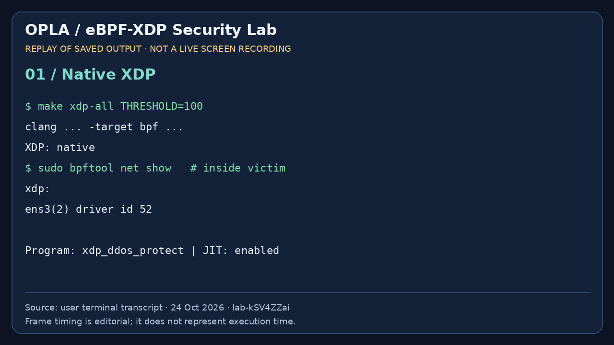
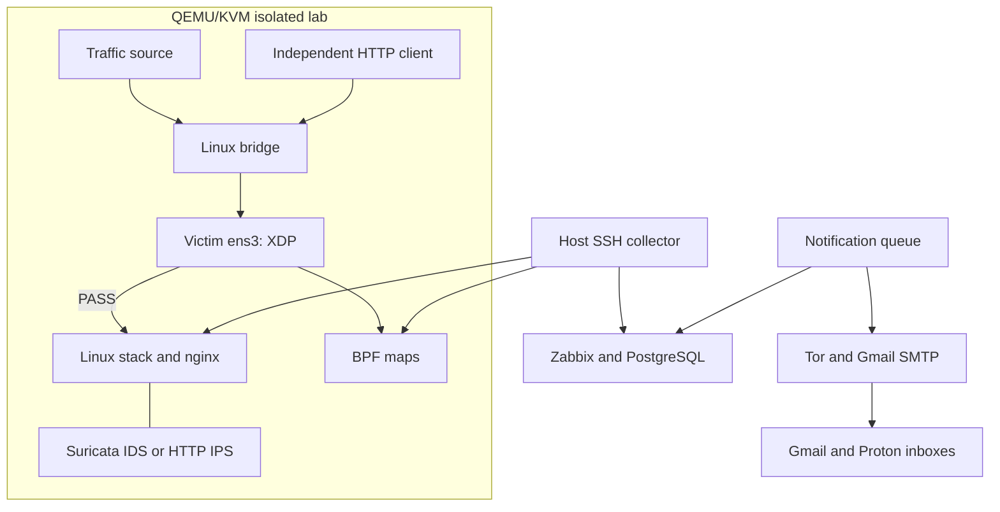

# OPLA Security Lab

[Русский](README.ru.md) · **English**

**Reproducible Linux network-security experiments with eBPF/XDP, Suricata IDS/IPS, Zabbix and verified recovery workflows.**

[](https://github.com/zackshal/opla-security-lab/actions/workflows/check.yml)


Badges record the observed environment, not a recommended current security baseline or immutable package lock. Bash was not recorded; Ansible core 2.19.3 was used for syntax validation only. See [versions](docs/versions.en.md).

[Quick start](#quick-start) · [XDP](#ebpfxdp-protection) · [Zabbix](#zabbix) · [Deployment](docs/deployment.en.md)

[Component map](docs/architecture.en.md) · [Acceptance matrix](docs/acceptance.en.md)

> **Status: laboratory release candidate.** Native XDP and selected defenses were tested live. GitLab pipeline [2985024140](https://gitlab.com/k3rnel_co0n/opla-security-lab/-/pipelines/2985024140) passed for 96ef03bb. Cold installation, full host-reboot recovery and dedicated-server Ansible deployment require separate acceptance. This is not universal L2–L7 protection or a claim of production readiness.

## Capabilities

OPLA links a test packet to BPF counters, Suricata events, HTTP responses, Zabbix problems and notifications. Three VMs separate test generation, the protected service and an independent client.

- XDP validates packet headers, limits initial TCP SYNs and detects distinct-port scans.
- Suricata operates as AF_PACKET IDS or selected HTTP NFQUEUE IPS.
- nginx limits HTTP requests and writes structured logs.
- Zabbix provisions managed hosts, items, preprocessing, triggers, graphs and dashboards.
- A persistent queue sends Warning+ and recovery events to Gmail and Proton through Gmail SMTP/TLS over Tor.
- QMP handles individual VM snapshots; separate commands create validated standalone disk copies and database dumps.
- CI checks portable logic/configuration and builds a checksummed BPF package.

## Demonstration



[MP4](assets/demo/terminal-replay.mp4) · [Recorded numerical results](assets/demo/observed-results.json)

This is an editorial replay of previously captured output, not a new live recording or a performance benchmark. It shows earlier SYN/HTTP experiments and historical item counts. Current scan policy and CI differ; new dashboard screenshots are not included.

## Architecture



Read current VM addresses from the selected lab state. The observed /29 used host 100.64.0.1, attacker .2, victim .3 and client .4; these are not universal constants. IDS uses AF_PACKET; HTTP IPS queues selected HTTP/80 requests and replies to NFQUEUE 42. Native XDP can drop before ordinary packet capture sees traffic.

## Requirements

| Component | Requirement / observed environment |
|---|---|
| Host | Linux amd64, systemd, sudo, /dev/kvm, dedicated lab machine |
| Virtualization | QEMU, qemu-img, cloud-image-utils, dnsmasq, libguestfs, socat |
| Management | Python 3/PyYAML, Bash, OpenSSH, iproute2, nftables, curl, make, C compiler |
| Monitoring | Docker Engine and Compose plugin |
| Resources | Practical baseline: 8 GiB RAM and 20 GiB disk; backups need more |
| Observed | Debian 13/QEMU 10 host; Debian 12/kernel 6.1 guests; clang 14, bpftool 7.1, Suricata 7.0.10 |
| Portable checks | gcc libc6-dev linux-libc-dev make python3 python3-yaml qemu-utils |

`bin/install-host.sh` targets a clean Debian 12 host; it is not a universal Debian 13/Ubuntu/Astra installer. Do not run it on a working machine just to check dependencies. Management expects ~/.ssh/id_ed25519; private keys do not belong in Git.

Images download separately. Lab guests have no external default gateway/DNS and use scoped nftables isolation. Prepare guest images through libguestfs instead of exposing guests to the Internet.

## Quick start

Clone this repository or use Code → Download ZIP. Run commands from its root on a prepared dedicated host:

```bash
make bootstrap
make image ROLE=attacker
make image ROLE=client
make image ROLE=victim
make up
make ready
export LAB_DIR="$(python3 bin/state.py --latest)"
```

Stop on any failed command. In the observed Debian 12 setup, Suricata/libhtp2 needed matched bookworm-backports packages installed manually on a stopped victim. The ordinary prepare-image --install path has not been accepted as a fully automated cold build. Separate role images reduce packages; fallback to the victim image can defeat this optimization. Nmap/arp-scan/Yersinia were added separately to the tested attacker and are not installed by the current image script.

```bash
make xdp-all THRESHOLD=100 MAX_SOURCES=4096
make xdp-stats
make monitoring-up
```

Expect loaded=1 and inspect attachment mode. Native is attempted first; generic fallback does not imply native performance. Existing programs are not overwritten automatically. Reloading intentionally via xdp-unload then xdp-all interrupts protection and resets maps.

Open http://127.0.0.1:8080 and change the initial Admin/zabbix password. Then:

```bash
bash bin/observability-up.sh
make ids
make ids-status
bash bin/scan-detector.sh start
```

Observability setup installs HTTP policy, copies the collector, provisions Zabbix and starts collection. It does not automatically attach XDP or enable IDS/passive detection. For HTTP IPS use `make ips` instead of `make ids`. Engine failure can close the selected IPS path; preserve separate management access.

## eBPF/XDP protection

Source: [xdp_ddos_protect.c](xdp/xdp_ddos_protect.c).

| Mechanism | Scope |
|---|---|
| Ethernet/VLAN/IPv4/TCP parser | Boundary/IHL/TCP-length checks; up to two VLAN tags |
| SYN rate limit | Initial IPv4 TCP SYN per source; default 100 per fixed second |
| Fragment policy | Fragmented IPv4 TCP is dropped in this lab profile |
| Scan detection | Eight distinct destination ports per IPv4 source in a fixed 60-second window |
| Temporary ban | Block mode drops new SYNs from that source for 30 seconds |
| Bounded source map | Default 4096; insertion failure drops SYN and increments map_full |

Choose one mode:

```bash
bash bin/xdp-scan-policy.sh observe
```

Use `block` for prevention or `off` to disable only scan policy. New maps default to off. The two trusted sources bypass scan policy only, not SYN rate limiting. The wrapper obtains management/client addresses from lab state. Initial probes below threshold, ARP discovery, established traffic and ACKs are not blocked by scan policy.

Maps are `syn_windows` (source/scan state and lock), `xdp_policy` (mode/trust), and `xdp_stats` (seven per-CPU counters), pinned under /sys/fs/bpf/opla/maps; the program is /sys/fs/bpf/opla/program. Counters: syn, pass, drop, map_full, fragment_drop, xdp_scan_events, xdp_scan_drop. Scan drops are included in total drops. SYN counters do not count all traffic or every malformed packet. The collector sums CPUs.

loaded=1 is a boolean, not a sensor count. RX comes from sysfs, HTTP from logs/probes and IDS from EVE; these are not additional BPF maps.

## Zabbix

Provisioning manages **49 items (34 raw + 15 rates), 23 triggers, five graphs and a five-page dashboard**:

| Page | Content |
|---|---|
| XDP and events | Attachment, mode, SYN/drop/map pressure and scan policy |
| HTTP protection | Requests, limits, errors and local probe |
| Interface traffic | RX counters and rates |
| IDS and IPS | Engine state, alerts, block decisions and EVE errors |
| Port-scan detection | Passive Python detector, heartbeat and bounded source state |

Repeat `make monitoring-configure` updates managed objects; clone a dashboard for private changes. Zabbix policy thresholds do not change XDP/nginx prevention.

```bash
make monitoring-stop
python3 monitoring/diagnose.py --lab "$LAB_DIR"
make monitoring-start
lab_id="${LAB_DIR##*/}"
journalctl --user -u "opla-monitor-$lab_id.service" -n 30 --no-pager
docker compose --env-file monitoring/.env -f monitoring/compose.yaml logs --tail 30
```

Diagnostics and collection share a lock. Check sample freshness and clear stale UI filters. Rates need fresh samples after preprocessing changes. Read-only SQL is in monitoring/sql. PostgreSQL is not published; web/trapper bind to localhost 8080/10051. Stored metrics are not full packet capture or every nginx log record.

## Notifications

```bash
python3 monitoring/alert_delivery.py configure --host "opla-${LAB_DIR##*/}"
python3 monitoring/alert_delivery.py test
python3 monitoring/alerts_service.py install
python3 monitoring/alert_delivery.py status
```

Needs a Zabbix 7.0 token with suitable permissions, Gmail app password and host SOCKS5 at 127.0.0.1:9050. Interactive setup saves secrets outside Git in ~/.config/opla/alerts.json with mode 0600.

Both inboxes receive Warning+ and recovery notifications. Free Proton is a recipient; Gmail is the STARTTLS SMTP sender. These are two destinations sharing one transport, not independent delivery channels. The SQLite queue tracks recipient attempts. SMTP acceptance is not inbox receipt, and ambiguous SMTP responses can cause duplicates. PROBLEM delivery was observed; RECOVERY has unit coverage but still needs a separate live check. Initial polling may notify existing problems.

## Snapshots and backup

```bash
make monitoring-stop
make vm-save VM=client TAG=before-change
make vm-snapshots VM=client
make vm-load VM=client TAG=before-change ROLLBACK=yes
make monitoring-start
```

Rollback discards later state of one VM; it is not an atomic backup of VMs plus external database.

```bash
make vm-backup BACKUP_DIR="$HOME/opla-backups/disks-$(date +%Y%m%d-%H%M%S)"
make backup-db BACKUP_DIR="$HOME/opla-backups/db-$(date +%Y%m%d-%H%M%S)"
```

Disk backup rejects running QEMU, creates standalone copies and verifies structure/hashes. Restore retains the replaced disk. Backups/snapshots are private. `vm-resume` starts retained VMs; `make down` deletes the selected lab.

## Validation and experiments

| Layer | Check | Evidence |
|---|---|---|
| Portable | make check | Python logic, syntax and C packet harness with mocked helpers/time |
| Build | make -C xdp with clang/libbpf | BPF compilation |
| Kernel | Real load and bpftool | Verifier/attachment on that kernel |
| Live | Counter deltas, generator, independent client | A particular policy under tested conditions |
| Recovery | QMP marker and isolated pg_restore | Tested recovery scenario |

```bash
bash bin/traffic-scenario.sh syn
bash bin/traffic-scenario.sh ack
bash bin/traffic-scenario.sh http
make ids-test
```

Evidence goes to reports/. ids-test exit status alone is not acceptance: correlate EVE SID 9001100/9001200, alert/block deltas and ordinary HTTP 200. hping loss is not XDP drop percentage.

Observed: native XDP, SYN limiting, scan observe/block, attacker HTTP timeout then recovery after TTL, negative three-port control, IDS marker alert and IPS marker block, PROBLEM email, client QMP marker rollback and isolated PostgreSQL restore. Continuous client availability during every enforcement experiment remains a separate test.

```bash
sudo bpftool net show
sudo bpftool prog show pinned /sys/fs/bpf/opla/program
sudo bpftool -p map dump pinned /sys/fs/bpf/opla/maps/xdp_stats
```

Do not combine counters across map recreation. Source window age is not last-seen time. Old EVE parse-error totals do not reset automatically after a parser fix; compare deltas.

## Ansible and deployment choices

Existing playbooks: [site.yml](ansible/site.yml), [lab-host.yml](ansible/lab-host.yml), [preflight.yml](ansible/preflight.yml). See [deployment](docs/deployment.en.md) for local/SSH/VPN/bastion inventories. Server profile is a dedicated Debian 13 installation, not the three-VM lab. VPN routing must already exist; credentials/Vault stay outside Git.

```bash
ansible-playbook -i ansible/inventory.example.ini ansible/site.yml --syntax-check
ansible-playbook -i ansible/inventory.lab-local.example.ini ansible/lab-host.yml --syntax-check
ansible-playbook -i ansible/inventory.local.example.ini ansible/preflight.yml --syntax-check
```

Do not apply server configuration to a working laptop or Debian 12 lab victim.

## Runbooks

| Task | Guide |
|---|---|
| Services, interfaces, maps and diagnostics | [Operations](docs/operations.en.md) |
| QMP, offline copies and PostgreSQL recovery | [Backup and restore](docs/backup-restore.en.md) |
| Stop, retain and delete data | [Data lifecycle](docs/data-lifecycle.en.md) |
| Local/remote installation | [Deployment](docs/deployment.en.md) |
| Public ancestry and attribution | [Git history](docs/git-history.en.md) |
| Environment evidence | [Versions](docs/versions.en.md) |

## CI/CD

[GitLab](.gitlab-ci.yml) · [GitHub Actions](.github/workflows/check.yml) · [Packaging](ci/package.sh) · [Deployment guards](ci/deploy.sh)

Portable and configuration jobs precede BPF build/package. Packages include object, COMMIT, BUILD, VALIDATION and SHA-256; compiler/package metadata is not an independent signature.

The historical four-job GitLab success is tied to 96ef03bb. Inspect the current workflow for later revisions. GitLab's local project runner runs one job at a time, 2 CPU/2 GiB per job; job containers do not receive the Docker socket, but the trusted runner manager does. It is not an untrusted-code sandbox.

The local Tor/obfs4 proxy and bridge updater are separate tooling, not prerequisites for GitHub hosted CI. Host firewall must permit CI egress; an HTTP proxy is not a network kill switch. BPF build avoids unnecessary test artifacts; direct downloads are disabled after a CDN 403. Tests 0 indicates no JUnit report, not no executed tests.

Server deployment is disabled by default and requires a manual protected job and `opla-deploy` runner. Syntax checks are not live deployment acceptance.

## Limits and trust

- No universal block of Nmap, Yersinia or arp-scan. Scan policy covers new IPv4 TCP SYN, not IPv6/UDP/established sessions. NAT combines users by source IP.
- HASH state has no automatic eviction/GC. Fixed windows permit boundary bursts; many-source scaling is not accepted.
- IPS covers the selected HTTP path, does not decrypt HTTPS and is not a full WAF.
- Local HTTP probes do not replace an independent client during blocking.
- Collector queues are bounded; rotation/restarts require epoch/loss handling.
- sudo, Docker access and BPF are powerful privileges; use a dedicated host and preserve management access.
- No signed releases, independent audit, maximum-pps measurement or proven speedup over netfilter.

## Source layout

| Directory | Responsibility |
|---|---|
| xdp | BPF C program, loader, maps, policy and collector |
| bin / cloud-init | VM lifecycle, scenarios, QMP and backup |
| security | Suricata, nginx and passive scan detection |
| monitoring | Zabbix, telemetry, SQL and email |
| ansible / deploy | Dedicated-server profile |
| tests | Unit/integration checks and packet harness |
| ci / .github | Validation and packaging |
| assets/demo | Historical replay and numerical evidence |

Public sources exclude academic PDF/DOCX, runtime, qcow2 and database dumps. GitHub sources do not require private GitLab access; private pipeline links require membership. Public history import is already complete; do not repeat it for normal updates.

See [contributing](CONTRIBUTING.en.md), [security](SECURITY.en.md) and [licensing](LICENSING.en.md). Issues should include revision, environment, commands, expected/actual behavior and anonymized counter deltas. Do not upload credentials, private dumps or third-party packet captures. Existing legal notices in LICENSE and the BPF source are preserved.
