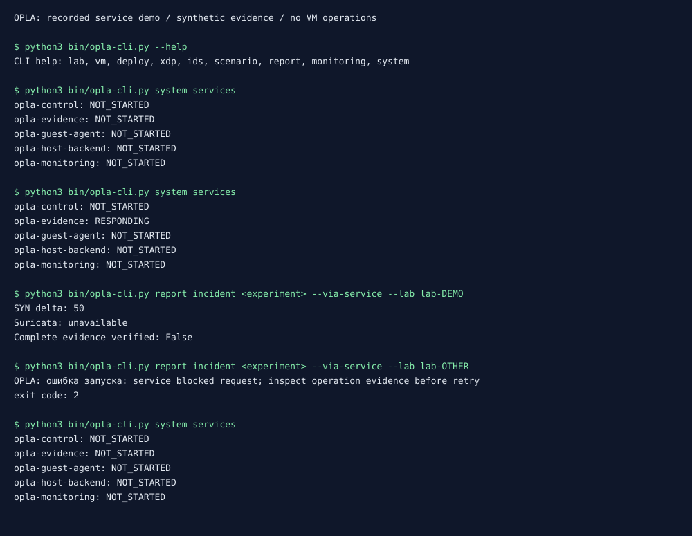

# Записанная демонстрация сервисов

Это реальный вывод CLI и отдельных процессов с синтетическими evidence.
VM, SSH, Docker и сетевые правила хоста не изменялись.



[Полный stdout/stderr, exit codes, fixtures и hashes](transcript.json)

## Шаг 1

```text
$ python3 bin/opla-cli.py --help
CLI help: lab, vm, deploy, xdp, ids, scenario, report, monitoring, system
```

## Шаг 2

```text
$ python3 bin/opla-cli.py system services
opla-control: NOT_STARTED
opla-evidence: NOT_STARTED
opla-guest-agent: NOT_STARTED
opla-host-backend: NOT_STARTED
opla-monitoring: NOT_STARTED
```

## Шаг 3

```text
$ python3 bin/opla-cli.py system services
opla-control: NOT_STARTED
opla-evidence: RESPONDING
opla-guest-agent: NOT_STARTED
opla-host-backend: NOT_STARTED
opla-monitoring: NOT_STARTED
```

## Шаг 4

```text
$ python3 bin/opla-cli.py report incident <experiment> --via-service --lab lab-DEMO
SYN delta: 50
Suricata: unavailable
Complete evidence verified: False
```

## Шаг 5

```text
$ python3 bin/opla-cli.py report incident <experiment> --via-service --lab lab-OTHER
OPLA: ошибка запуска: service blocked request; inspect operation evidence before retry
exit code: 2
```

## Шаг 6

```text
$ python3 bin/opla-cli.py system services
opla-control: NOT_STARTED
opla-evidence: NOT_STARTED
opla-guest-agent: NOT_STARTED
opla-host-backend: NOT_STARTED
opla-monitoring: NOT_STARTED
```

SVG — визуализация сохранённого вывода, не скриншот и не измерение производительности.
Синтетический lab-DEMO не является созданной лабораторией.
