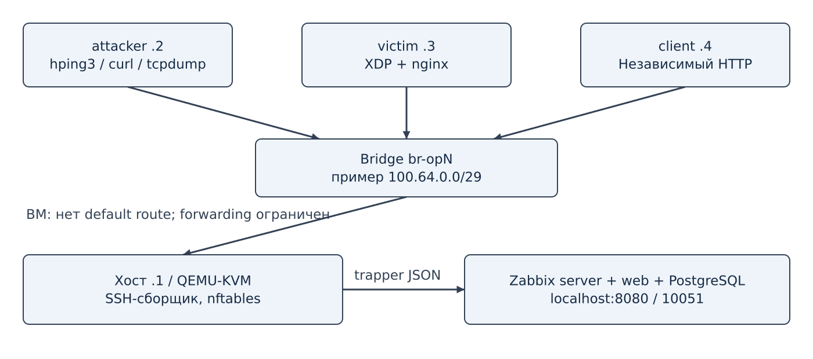
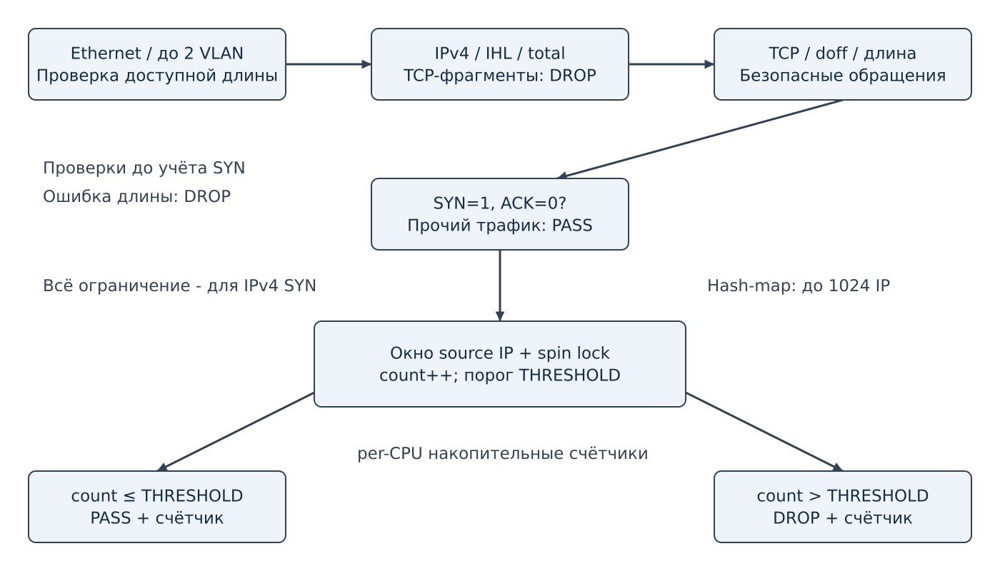

# Методические указания: наблюдаемая защита HTTP-сервиса на Linux

**Русский** · [English](methodology.en.md)

Практическая работа по дисциплине «Обнаружение, предупреждение и ликвидация последствий компьютерных атак».

Автор-разработчик: Шалашов Захар, студент 4-го курса бакалавриата направления «Информационная безопасность», группа БББО-01-23, РТУ МИРЭА. Москва, 2026. Редакция 25.10.2026.

## 1 Аннотация, цель и задачи

Эту лабораторную работу я подготовил для изучения связи между сетевой нагрузкой, решением защитного механизма и результатом, который можно проверить. В качестве основы я использовал три виртуальные машины QEMU/KVM: attacker, victim и client. В ходе работы студент проверяет ограничение SYN на eBPF/XDP, подключает Zabbix и сопоставляет счётчики с доступностью HTTP. Дополнительный сценарий использует HTTP rate limiting nginx и постоянные соединения, чтобы отделить сетевое ограничение от прикладного.

Цель разработанной мной работы — дать возможность на практике исследовать механизмы защиты Linux и понять границы их применимости. Задачи: установить средства; проверить изоляцию; прочитать и собрать C-программу; выполнить одинаковые конечные нагрузки; получить телеметрию; объяснить результат; подготовить отчёт с воспроизводимыми доказательствами.

Предполагаются базовые знания TCP/IP, Linux shell и SSH. Высокая частота пакетов - наблюдаемый признак, но не самостоятельное доказательство злого умысла. Работа выполняется исключительно в выделенной виртуальной сети.

## 2 Теоретическая часть

### 2.1 TCP и SYN flood

TCP-соединение начинается обменом SYN, SYN+ACK и ACK. При незавершённом установлении на стороне сервера может сохраняться состояние SYN-RECV. Частый поток начальных SYN способен расходовать ресурсы обработки и таблиц соединений. Эффект зависит от ОС, SYN cookies, очередей, сервиса и мощности генератора: небольшой тест не обязан вызвать недоступность.

В проекте учитываются только IPv4/TCP-пакеты с SYN=1, ACK=0. Для каждого адреса источника используется фиксированное окно. После достижения THRESHOLD последующие SYN этого окна отбрасываются. Разрешённые ACK, UDP, ICMP и IPv6 не превращаются в безопасные автоматически: данный механизм не оценивает их содержимое и интенсивность.

Окно привязано к источнику, а не к общему секундному таймеру. В конце одного окна и начале следующего возможен всплеск. Клиенты за NAT делят лимит. У распределённого потока много источников, поэтому один per-IP limiter не является полной DDoS-защитой.

### 2.2 eBPF/XDP и проверка безопасности программы

XDP исполняет BPF-программу при приёме кадра. Native работает в поддерживающем драйвере до обычного пути skb; generic использует другой участок сетевого пути. В зависимости от результата программа пропускает или отбрасывает кадр. Загрузка программы и её привязка к интерфейсу - разные операции.

Verifier анализирует доступ к памяти, типы регистров, границы пакета и допустимые helpers. Успешная компиляция Clang ещё не означает успешную загрузку. В этой работе наблюдался отказ операции ip+total. Его устранили сравнением заявленной длины с доступным количеством байтов, сохранив проверки TCP.

Состояние source IP хранится в hash-map syn_windows на 1024 записи. Spin lock защищает оконные count/start_ns при работе нескольких CPU. Накопительная per-CPU array xdp_stats уменьшает совместный доступ к счётчикам; сборщик складывает значения CPU. Оконный count не подходит для расчёта общей скорости.

### 2.3 HTTP rate limiting

HTTP-нагрузка может использовать уже открытые TCP-соединения, поэтому число запросов не равно числу SYN. nginx limit_req ограничивает запросы по адресу TCP-клиента. В учебной конфигурации установлены 5 запросов/с, burst=10 и код 429 при превышении. Таймеры и ограничение размера тела уменьшают некоторые виды расхода ресурсов, но не заменяют WAF и исправление приложения.

SQL injection и XSS требуют иных мер: параметризованных запросов, корректного кодирования вывода, анализа приложения и при необходимости WAF. Проект не обещает защиту от всех атак L2-L7. Для сравнения подходов приложена отдельная матрица покрытия.

### 2.4 Обнаружение, предотвращение и наблюдаемость

Предотвращение здесь выполняют XDP_DROP и nginx limit_req. Zabbix хранит показатели и вычисляет условия событий. Порог Zabbix сам по себе не меняет фильтр. Alert Suricata обнаруживает совпадение с правилом; блокировка требует отдельного IPS-пути и проверки.

Скорость определяется разностью накопительных значений за фактический интервал. После перезагрузки карты сбрасываются, отрицательная разность не означает отрицательный трафик. Отсутствие свежих значений означает неизвестное состояние канала сбора; его нельзя заменять нулевой нагрузкой.

Важны три разных доказательства: генератор отправил поток; фильтр принял решение; независимый клиент получил услугу. Ни HTTP access.log, ни график drop по отдельности не доказывают все три условия.

## 3 Стенд и программные средства



| Узел | Адрес примера | Назначение | Ресурсы |
|---|---|---|---|
| Хост | 100.64.0.1 | Bridge, QEMU, SSH-сборщик, контейнеры | KVM, резерв 12 GiB RAM и 30 GiB диска для планирования |
| attacker | 100.64.0.2 | hping3, curl, tcpdump | 1 vCPU, 1 GiB RAM |
| victim | 100.64.0.3 | Linux XDP и nginx | 2 vCPU, 2 GiB RAM |
| client | 100.64.0.4 | Независимая HTTP-проверка | 1 vCPU, 512 MiB RAM |

Ресурсы - расчётный ориентир, не измеренный минимум. Скрипт выбирает свободную /29 из 100.64.0.0/10, поэтому фактические адреса берутся из state.env. Состояние и overlays находятся в /var/lib/opla/lab-ID. Базовый qcow2 находится в каталоге images/ проекта, контейнерная БД - в отдельном Docker volume.

Хост устанавливается отдельно от гостевых ВМ. Автоматический install-host.sh целится в Debian 12; показанный пользователем рабочий хост содержит пакеты deb13. Это подтверждение совместимости конкретного запуска, а не проверенная чистая установка Debian 13. Точные версии и лицензии см. в software.md.

## 4 Подготовка среды

### Шаг 1. Подготовить Linux-хост

На отдельном чистом Debian 12 amd64 с аппаратной виртуализацией из корня проекта:

```bash
sudo ./bin/install-host.sh
ls -l /dev/kvm
docker compose version
```

Ожидается доступное устройство KVM и Compose v2. Для обычного пользователя настройте разрешённый доступ к Docker и повторно войдите в сессию. Группа docker даёт административные возможности на хосте; не используйте общий рабочий сервер как учебный генератор.

Проверьте наличие ~/.ssh/id_ed25519.pub. Если ключа нет, создайте его командой ssh-keygen -t ed25519. Скрипты по умолчанию используют ~/.ssh/id_ed25519. Не добавляйте приватный ключ в репозиторий.

### Шаг 2. Подготовить образы

```bash
make bootstrap
LIBGUESTFS_BACKEND=direct make image
```

bootstrap загружает Debian cloud image, сверяет SHA512 и записывает SHA256/URL. prepare-image.sh создаёт расширенный образ и устанавливает nginx, Clang, libbpf, bpftool, hping3, curl, tcpdump и зависимости до изолированного запуска.

Не меняйте backing image работающих ВМ. Если подготовленный образ уже существует, скрипт не перезаписывает его. Для обновления образа сначала завершите стенд и сохраните результаты; исходный образ и его хеш храните отдельно. Загрузка по latest не гарантирует одинаковый пакетный состав через месяц: фиксируйте manifest, URL и контрольные суммы.

### Шаг 3. Запустить выбранный стенд

```bash
make up
export LAB_DIR="$(python3 bin/state.py --latest)"
make ready
python3 bin/state.py "$LAB_DIR" VICTIM_IP
```

Ожидаются три status: done. До готовности SSH возможны Connection refused/No route to host; это не результат теста защиты. При cloud-init error прочитайте /var/log/cloud-init-output.log внутри нужной ВМ. Наблюдавшееся отсутствие nginx устранялось подготовкой образа, а не повторением make ready.

Команды make выполняются на хосте из корня проекта. Внутри SSH-сеанса приглашение student@victim/client/attacker; возврат на хост - exit. В reports/ нет Makefile, поэтому команды управления там не запускаются.

## 5 Проверка изоляции

### Шаг 4. Сопоставить состояние и сеть

```bash
python3 bin/state.py "$LAB_DIR" LAB_ID
python3 bin/state.py "$LAB_DIR" BRIDGE
sudo nft list ruleset
make ssh VM=victim
ip -4 addr show dev ens3
ip route
exit
```

Ожидается адрес фактической /29 и отсутствие default route. Правила nftables конкретного экземпляра запрещают маршрутизацию через хост и новые обращения ВМ к хосту, кроме разрешённого DHCP. Сохраните вывод; одну только схему не считайте доказательством изоляции.

Для отдельной проверки forwarding используйте заранее согласованный тестовый HTTP-узел, доступный с хоста. Внутри учебной ВМ временно задайте default через GW этого стенда и убедитесь, что nftables всё равно блокирует выход. Затем удалите временный маршрут. Отсутствие внешнего узла само по себе не доказывает фильтрацию. Фактический результат этой проверки в имеющихся материалах ещё не представлен.

## 6 Загрузка и наблюдение XDP



### Шаг 5. Проверить исходники и загрузить программу

```bash
make check
make xdp-all THRESHOLD=100
make xdp-stats
make versions
```

Ожидаются актуальный набор Python-тестов и PASS C-проверки, затем успешные Clang/verifier и loaded=1. Если XDP уже подключена, сохраните текущие результаты, выполните make xdp-unload и повторите xdp-all. Неудачная загрузка не меняет работающий порог.

```bash
make ssh VM=victim
sudo bpftool net show
sudo bpftool prog show pinned /sys/fs/bpf/opla/program
sudo bpftool -p map dump pinned /sys/fs/bpf/opla/maps/xdp_stats
exit
```

Проверяйте native/driver, JIT, программу и карты, не конкретный ID. ID меняется при перезагрузке. В JSON per-CPU значения суммируются; бинарный ключ IPv4 в syn_windows может отображаться целым числом.

### Шаг 6. Выполнить базовый опыт с независимым клиентом

В одном терминале хоста войдите в client:

```bash
make ssh VM=client
```

Внутри client для адреса примера:

```bash
for i in $(seq 1 60); do
  printf '%s ' "$(date -Is)"
  curl --max-time 3 -sS -o /dev/null \
    -w 'HTTP=%{http_code} time=%{time_total}s\n' http://100.64.0.3/
  sleep 1
done
```

Одновременно во втором терминале хоста:

```bash
bash bin/traffic-scenario.sh syn
```

Сохраняются before.json, after.json, генератор, код завершения и контекст в reports/scenario-syn-*. Ожидается рост drop при превышении порога, при этом client проверяет собственный адрес источника. Сравнивайте разности накопительных счётчиков внутри опыта. Учитывайте фоновые SYN от SSH.

### Шаг 7. Сравнить конфигурации

Сначала сохраните опыт без XDP: make xdp-unload, тот же генератор и та же клиентская проверка. Затем отдельно выполните успешную загрузку с THRESHOLD=100 и THRESHOLD=200. Повторите одинаковую нагрузку для каждого порога. Не вычитайте счётчики разных загрузок друг из друга.

Если HTTP работает и без фильтра, вывод ограничивается подтверждением отбрасывания SYN; улучшение доступности при данной нагрузке не установлено. Не увеличивайте интенсивность вне возможностей выделенного стенда только ради ошибки HTTP.

## 7 Zabbix и прикладная защита

### Шаг 8. Настроить наблюдаемость

```bash
make monitoring-up
```

Откройте http://127.0.0.1:8080, дождитесь готовности БД и смените Admin/zabbix. Затем:

```bash
bash bin/observability-up.sh
```

Скрипт устанавливает security/nginx/opla-l7.conf с nginx -t/reload, развёртывает collect.py, запрашивает пароль Zabbix API, создаёт/обновляет 49 items, 23 triggers, 5 graphs и пять страниц dashboard. Управляемая панель заменяется, поэтому свою ручную панель заранее клонируйте.

В Latest data сбросьте старые фильтры, выберите текущий opla-ID. На странице XDP and events смотрите loaded, mode, SYN и события; на HTTP protection - код, время, запросы и отказы; на Interface traffic - RX. Отсутствие свежести и нулевой drop - разные состояния.

### Шаг 9. Проверить HTTP-ограничение

```bash
bash bin/security-http-test.sh
```

200 запросов выполняются четырьмя работниками с повторным использованием соединений. Ожидаются 200 и 429, прирост http.limited и событие HTTP requests rate limited. Количество отказов определяется опытом. Одновременно повторяйте обычную проверку с client. Проверка http.up в Zabbix выполняется локально внутри victim и не доказывает доступность с другой ВМ.

### Шаг 10. Проследить путь до БД

```bash
make monitoring-stop
python3 monitoring/diagnose.py --lab "$LAB_DIR"
make monitoring-start
lab_id="$(python3 bin/state.py "$LAB_DIR" LAB_ID)"
docker compose --env-file monitoring/.env -f monitoring/compose.yaml exec -T db \
  psql -U zabbix -d zabbix -v "host_name=opla-$lab_id" \
  < monitoring/sql/security-overview.sql
```

Ожидаются 34 ACCEPTED входных значений, а затем свежие записи. По метрикам применяются разные таблицы history_uint/history/history_str/history_log. SQL только читает данные. График отражает интервальные снимки, а не каждый пакет.

### Шаг 11. Проверить отказ и восстановление

Остановите сборщик на время более 60 секунд, проверьте Collector has no data и повторно запустите. После восстановления должны обновиться значения и закрыться событие. Повторение make monitoring-stop при отсутствующей службе допустимо. Сохраните историю Problems, не только активный список.

## 8 Дополнительные сценарии и обработка ошибок

```bash
bash bin/traffic-scenario.sh ack
bash bin/traffic-scenario.sh udp
bash bin/traffic-scenario.sh icmp
bash bin/traffic-scenario.sh http
```

Эти сценарии конечны и показывают границы SYN-защиты. UDP без ответа не доказывает XDP_DROP: закрытый порт может отвечать ограниченными ICMP-сообщениями. Для наблюдения используйте tcpdump на attacker или victim с учётом места относительно native XDP. Дамп сохраняйте до make down.

| Ситуация | Проверка и действие |
|---|---|
| make не находит цель | Перейти в корень проекта |
| bpftool не найден при versions | PATH /usr/sbin учтён в скрипте; проверить пакет внутри victim |
| ВМ ready error | cloud-init status --long и cloud-init-output.log |
| На ens3 уже есть XDP | Сохранить результат, xdp-unload, затем xdp-all |
| Сборщик уже работает | monitoring-stop перед diagnose; не запускать два процесса |
| Zabbix принял часть значений | diagnose по ключам; проверить каталог и кеш конфигурации |
| У dashboard старые числа | Выбрать текущий LAB_ID, сбросить фильтры и проверить свежесть |
| nginx -t не прошёл | Скрипт откатывает свой файл; прочитать сообщение до повторного запуска |
| Время на ВМ отличается на 3 часа | Сопоставить UTC и Europe/Moscow через date -Is, не смешивать зоны |

Возможности по уровням L2-L7 и примеры Suricata описаны в dashboard-and-layers.md. Они не означают автоматическую установку IDS/WAF. Ни TLS, ни ARP spoofing отдельной политикой этого пакета не закрываются.

## 9 Содержание отчёта студента

В отчёт входят: цель; схема с фактическими адресами; версии и хеш образа; проверки изоляции; команды нагрузки и успешной загрузки; before/after; HTTP клиента; графики и события Zabbix; чтение БД; восстановление; ответы на вопросы; обоснованный вывод. Шаблон - report-template.md.

Для каждого опыта запишите commit, конфигурацию, время и место наблюдения. Значения из разных запусков не объединяйте в одну строку. Вывод «защита от всех атак» по одному SYN-опыту недопустим.

## 10 ФОС, контрольные вопросы и приложения

Пять практических заданий, вопросы и тест находятся в fos.md. Ключ ответов хранится только в закрытом комплекте преподавателя и не входит в публичный репозиторий. Источники: sources.md. Конфигурации: cloud-init/, security/, monitoring/. Код: xdp/, bin/, tests/. Схемы: docs/figures/. Дампы, версии и локальные журналы создаются при испытаниях и публикуются только после отбора.

Публичные PDF собираются из Markdown отдельно в release-artifacts/public и не отслеживаются Git. Методические материалы являются самостоятельной редакцией исходников: после изменения алгоритма или числа метрик их нужно пересобрать.
