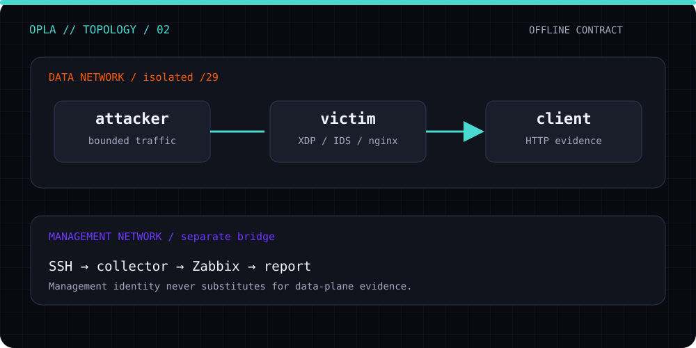
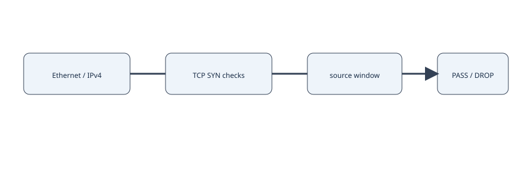

# Методические указания: обнаружение и ограничение сетевых атак в Linux

Практическая работа по дисциплине «Обнаружение, предупреждение и ликвидация последствий компьютерных атак».

РТУ МИРЭА. Разработчик: Шалашов Захар, группа БББО-01-23. Москва, 2026.
Редакция: 30.10.2026. Тема подлежит согласованию с преподавателем.

## 1 Аннотация

Цель — исследовать связь между тестовой сетевой нагрузкой, обнаружением атаки,
решением защитного механизма и доступностью HTTP для независимого клиента.
Студент разворачивает три Debian VM, проверяет изоляцию, наблюдает eBPF/XDP,
nginx и Suricata, сопоставляет телеметрию Zabbix с исходными свидетельствами и
восстанавливает штатное состояние стенда.

Необходимы базовые навыки Linux, TCP/IP и SSH. Работа выполняется на отдельном
допущенном Linux-хосте. Все генераторы направляются только на data-адрес victim
выбранной лаборатории. Открытые утилиты attacker не являются разрешением
проверять внешние адреса.

Полное воспроизведение текущей редакции на чистой системе ещё не подтверждено.
Исторический вывод оператора и offline-тесты обозначаются отдельно от новой
апробации. Критерии приёмки и остающиеся проверки приведены в
[матрице соответствия ТЗ](requirements-traceability.md).

## 2 Теоретическая часть

### 2.1 TCP SYN flood и сканирование портов

TCP устанавливает соединение обменом SYN, SYN+ACK и ACK. Множество начальных
SYN может расходовать ресурсы сервера и очереди соединений. Реальный эффект
зависит от SYN cookies, настроек ядра, сервиса и интенсивности потока. Высокая
частота SYN сама по себе не доказывает злой умысел. Сканирование разных портов
одним источником — другой наблюдаемый признак: его следует отличать от частых
обращений к одному HTTP-порту.

В OPLA limiter учитывает IPv4 TCP SYN без ACK. По source IP ведётся фиксированное
окно: по умолчанию 100 SYN за 1 секунду, до 4096 источников. Превышение лимита
даёт XDP_DROP. Источники за NAT делят лимит, распределённая нагрузка может его
обходить, а всплеск на границе окон требует отдельного анализа. Scan policy
использует distinct destination ports: 8 портов за 60 секунд и TTL блока 30
секунд. Режим observe регистрирует признаки без scan-блокировки; SYN limiter
продолжает действовать. Два trusted source обходят scan policy, но не SYN limit.

### 2.2 eBPF/XDP

Verifier проверяет границы доступа, типы и допустимость операций программы в
ядре. Компиляция Clang не заменяет проверку verifier на целевом ядре. Native XDP
работает в драйверном пути, generic — при наличии skb; режимы нельзя считать
эквивалентными по производительности. XDP_PASS/XDP_DROP — решения на пакетах,
а не подтверждение завершённого TCP-соединения или HTTP-запроса.

В syn_windows хранятся состояние источников и spin lock; накопительная
per-CPU map xdp_stats агрегируется сборщиком. Скорость считают как разность
накопительных значений за фактический интервал. После перезагрузки BPF map
разности между старым и новым снимками недопустимы. Program ID, tag, map IDs,
receipt и hashes связывают наблюдение с загруженной программой.

### 2.3 Suricata, HTTP и наблюдаемость

Suricata анализирует трафик и выдаёт EVE JSON alert при совпадении с правилом.
IDS наблюдает; IPS дополнительно требует проверенного inline-пути. Правило
alert и рост ids_alerts не доказывают блокировку. В native XDP отброшенный пакет
может не попасть в Suricata или tcpdump внутри victim, поэтому события разных
датчиков нельзя считать равными по количеству.

nginx limit_req ограничивает HTTP-запросы, включая запросы по уже открытому
TCP-соединению. Код 429 относится к прикладному ограничению и отличается от
сетевого timeout. Zabbix хранит метрики и создаёт события; его trigger сам по
себе не меняет XDP policy. Отсутствие свежих данных означает неизвестное
состояние канала наблюдения, а не нулевую нагрузку.

Ограничение последствий в работе состоит в сохранении evidence, прекращении
конечного генератора, проверке доступности с client и восстановлении датчиков
и мониторинга. SQLi, XSS, расшифровка TLS и полная защита от DDoS в эту работу
не входят. Практический результат — обоснованное сравнение средств ядра,
IDS/IPS и мониторинга, включая их ограничения. Источники: [список литературы](sources.md).

## 3 Стенд и средства



Рисунок 1 показывает роли; актуальная реализация имеет две сети: data ens3 и
management ens4. Для каждого lab создаются отдельные bridge и /29 subnet.
Адреса выбирает allocator; адреса схемы являются примером. Управление SSH идёт
через management network, XDP подключается к ens3 victim. Топология и границы:
[dual NIC](task-dual-nic-topology.md), [host specification](test-host-spec.md).

Таблица 1 — Ресурсы VM

| Роль | vCPU | RAM | Виртуальный диск нового образа |
|---|---|---|---|
| attacker | 1 | 1024 MiB | 4 GiB |
| victim | 2 | 2048 MiB | 10 GiB |
| client | 1 | 512 MiB | 4 GiB |

Create требует 5120 MiB MemAvailable. Для полного опыта с контейнерами,
логами и резервными копиями рекомендуется планировать хост с 12 GiB RAM и
не менее 30 GiB свободного диска; это планирование, а не измеренный минимум.
Нужны x86_64, systemd, KVM и отдельный допущенный хост. Точные версии, лицензии,
назначение и установка приведены в [software](software.md) и [versions](versions.md).

## 4 Подготовка и развёртывание

### Шаг 1. Выбрать хост и способ установки

Действие: выделить чистый Debian 12/13 хост с аппаратной виртуализацией и
разрешением владельца. Путь: [быстрый старт](../README.md#быстрый-старт) и
[локальная установка](local-system-install.md). Ожидаемый результат: записаны
ОС, ресурсы, версии зависимостей и решение о допуске; рабочий Debian-хост
разработчика для этой проверки не используется.

### Шаг 2. Подготовить role images

Листинг 1 — Подготовка образов из проверенного checkout

```bash
make bootstrap
make images
python3 bin/opla-image-verify.py
```

Ожидаемый результат: проверены три role image, SHA-256, role/packages sidecars
и manifest внутри каждого guest image. Для victim устанавливаются Suricata,
PyYAML, nginx и BPF toolchain; attacker получает hping3, nmap, arp-scan,
yersinia и tcpdump. Рецепт victim согласованно устанавливает Suricata/libhtp
через bookworm-backports. Готовые образы переиспользуются; backing images
работающих VM не перезаписываются. При `.part` см. раздел 8.

### Шаг 3. Установить проверенный snapshot

Листинг 2 — Установка кода и образов на допущенном хосте

```bash
python3 bin/opla-system-install.py --source "$PWD"
sudo python3 bin/opla-system-install.py --source "$PWD" --install \
  --destination /opt/opla --expected-sha256 DIGEST
python3 /opt/opla/bin/opla-cli-install.py install
sudo install -d -o root -g root -m 0755 /var/lib/opla
```

DIGEST заменяется выводом первой команды после review исходников. Snapshot
должен быть новым: существующий каталог не перезаписывается. При обновлении
выберите новый путь и используйте его вместо `/opt/opla` во всех командах.
Локальный digest фиксирует байты и не является подписью издателя. Ожидается
root-owned установка и пользовательский wrapper. Копирование образов требует
дополнительного места; старые backing files сохраняются.

### Шаг 4. Создать лабораторию и выбрать её

Листинг 3 — Создание, выбор и проверка SSH

```bash
opla lab create --confirm-host-changes
opla lab list
opla lab select lab-XXXXXXXX
opla lab ready
opla lab status
```

Замените lab-XXXXXXXX напечатанным ID. Ожидаются три VM и cloud-init done для
каждой. Если создание прервалось, сначала выполните reconciliation по
[инструкции восстановления](user-guide/active-creation-recovery.md), а не
повторный create. Выбор хранится у пользователя; переменная LAB_DIR имеет
приоритет, поэтому удалите её из окружения, если она относится к старому lab.

### Шаг 5. Активировать защиту и dashboard

Листинг 4 — Общая активация выбранной лаборатории

```bash
opla lab activate lab-XXXXXXXX
opla xdp stats
opla ids status
```

Ожидаются build/verifier/attachment XDP, HTTP 200, активные scan detector и
Suricata, затем Zabbix/PostgreSQL, 49 items, 23 triggers и dashboard из пяти
страниц. Provisioning запросит учётные данные Zabbix интерактивно. Откройте
http://127.0.0.1:8080 и смените начальный пароль Admin/zabbix. Проверьте свежесть
Latest data текущего `opla-lab-...`; запуск процесса не доказывает доставку
метрик. При ошибке сохраните вывод и диагностируйте конкретный этап.

## 5 Выполнение опыта



### Шаг 6. Подтвердить изоляцию и сохранить baseline

Действие: по [руководству оператора](operator-guide.md) сохраните state,
bridge/TAP membership, policy именно своего lab и guest routes. Ожидается две
разные /29, SSH через management и запрет forwarding вне лаборатории. Проверку
выхода выполняет преподаватель только к согласованному тестовому endpoint.
Не считайте отсутствие default route самостоятельным доказательством firewall.
Запишите source commit, hashes role images, BPF object/program identity, время
UTC и исходные counters. Состав evidence: [протокол](run-protocol.md).

### Шаг 7. Выполнить ограниченный базовый сценарий

Листинг 5 — Проверка и запуск конечного сценария

```bash
opla scenario check syn-scan-baseline --lab lab-XXXXXXXX
opla scenario run syn-scan-baseline --lab lab-XXXXXXXX --confirm lab-XXXXXXXX
```

Ожидается конечный поток в data network, before/after и HTTP probe. Сохраните
путь report directory из вывода. Сравните delta syn/pass/drop; нулевой
scan_detected допустим и не заменяется утверждением о срабатывании scan policy.
HTTP probe в конце не доказывает доступность на всём интервале. Для такого
вывода приложите непрерывные результаты независимого client по
[client coverage](task-client-coverage.md). Без них вывод о сохранении
доступности ограничивается фактически измеренными точками.

### Шаг 8. Проверить Suricata и сравнить параметры

Листинг 6 — Безвредный IDS acceptance marker

```bash
opla ids test
opla ids status
```

Ожидается проверенный тестовый HTTP marker и связанный EVE alert, а не просто
активная служба. Сохраните sid, source/destination и временной интервал.
Сравните THRESHOLD=100 и 200: перед каждой пересборкой сохраните evidence,
штатно снимите свою XDP и загрузите новый объект из установленного каталога.
Команды: `make xdp-unload`, `make xdp-all THRESHOLD=200`. Повторите листинг 5.
Объясните ограничения compare без XDP: BPF counters при отсутствии программы
не применимы, а доступность измеряется независимым client. Не смешивайте
счётчики разных загрузок.

### Шаг 9. Проверить отказ и восстановление мониторинга

Листинг 7 — Отказ канала сбора без остановки защиты

```bash
opla monitoring stop
```

Дождитесь интервала trigger отсутствия данных из policy.json; сохраните
событие. Затем выполните `opla monitoring start`. Ожидаются новые значения и
recovery события. Сопоставьте отсутствие сбора, XDP loaded=0 и drop.rate=0.
Датчики защиты могут продолжать работу при остановленном collector.

Почта факультативна: [действия после API token](../README.md#после-создания-api-token-в-zabbix).
Обязательный опыт и оценивание обходятся без Gmail и других внешних почтовых
сервисов. Их использование требует отдельного согласования и не подтверждает
требование ТЗ об открытости средств лаборатории.

## 6 Содержание отчёта студента

Используйте [шаблон отчёта](report-template.md). Приложите цель; фактическую
топологию и изоляцию; полный manifest версий/лицензий; команды; временные
интервалы; hashes; verifier/attachment; counters; EVE; client coverage;
Zabbix Latest data и Problems; восстановление; ответы и ограничения выводов.
Каждая таблица и иллюстрация имеют номер и подпись. Пример консольного вывода
считается ожидаемым форматом, если не приложен фактический журнал этого опыта.

## 7 Фонд оценочных средств и контрольные вопросы

[ФОС](fos.md) содержит пять практических заданий, двенадцать вопросов самопроверки
и тест из пятнадцати вопросов с одним правильным ответом. Ключ и критерии
преподавателя передаются отдельно от студенческого PDF. Путь приватного
источника при локальной сборке — docs/teacher-key.md; он исключён из Git.

## 8 Возможные проблемы и восстановление

Таблица 2 — Диагностика

| Сообщение/наблюдение | Действие и ожидаемый результат |
|---|---|
| untrusted source directory | Установить новый root-owned snapshot; запускать его CLI. Не менять ownership рабочего checkout. |
| ssh_vm: command not found | Обновить snapshot с исправленным configure helper; пересоздание VM не требуется только из-за этой ошибки. |
| nginx не виден в command -v | Проверка учитывает /usr/sbin/nginx; сначала установить обновлённый код. |
| Suricata/libhtp dependency conflict | Использовать актуальный рецепт согласованного backports набора; сохранить candidate. |
| APT обращается к 127.0.0.1:10809 | В appliance это другой localhost. Актуальный recipe удаляет legacy proxy только из candidate; OPLA_GUEST_APT_PROXY задаёт доступный appliance proxy. |
| Оставлен .part | Проверить candidate и отсутствие использования; `opla system image-resume --role victim` продолжает проверенный candidate. Не удалять маской. |
| Нет monitoring.env при существующей БД | Автомиграция доступного legacy .env; иначе восстановить прежний секрет из backup. Не генерировать новый DB password. |
| recipients/api-token отсутствует | Установленная /opt-копия устарела; checkout и snapshot независимы. |
| Mail test: worker already running | Остановить пользовательскую почтовую службу для теста; после теста вернуть её. |
| API RuntimeError | Проверить enabled/expiry token, права host.get/problem.get/event.get и выбранный host. Старый last_poll_ok не доказывает текущий успех. |
| Чужие pins, lock или ownership mismatch | Сохранить evidence и прекратить операцию; не обходить проверки. |

## 9 Приложения и завершение работы

Приложение А — [cloud-init ролей](../cloud-init/), [правила Suricata](../security/suricata/opla.rules),
[nginx](../security/nginx/), [monitoring policy](../monitoring/policy.json).
Приложение Б — [XDP source](../xdp/xdp_ddos_protect.c), [сценарии](../scenarios/),
[offline tests](../tests/). Приложение В — [версии](versions.md), [источники](sources.md),
[матрица ТЗ](requirements-traceability.md), результаты данного опыта и
отдельно переданные qcow2/PCAP с hashes. Большие образы и дампы не добавляются в Git.

Листинг 8 — Остановка и подтверждаемое удаление одного стенда

```bash
opla monitoring stop
opla lab stop
opla lab delete lab-XXXXXXXX --confirm-lab lab-XXXXXXXX
opla lab list
```

Ожидается отсутствие удалённого lab в registry; общий Zabbix и история
сохраняются. Удаление всех стендов описано в [README](../README.md#удалить-все-лаборатории).
Backing images удаляются только после отдельной проверки ссылок всех VM.
Печатная версия собирается `make docs`; приватный ключ — отдельно
`make docs-teacher DOCS_PRIVATE_DIR=/tmp/opla-teacher`. Параметры сборки:
A4, основной шрифт 12 pt, интервал 1,5; итоговую вёрстку проверяет преподаватель.
